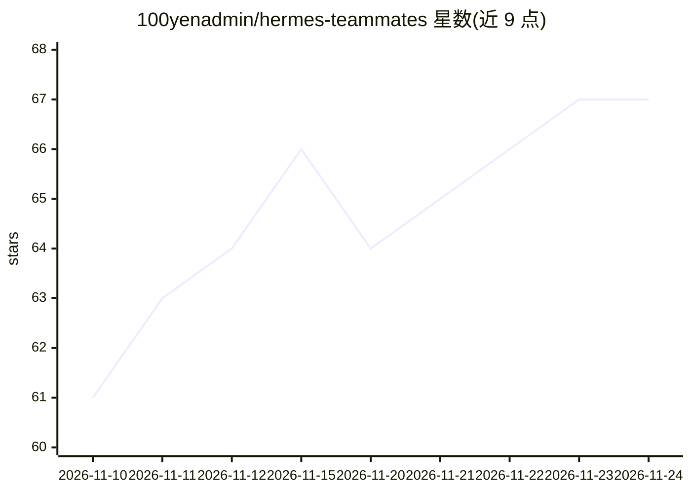

# 100yenadmin/hermes-teammates

⭐ 67 · Python · MIT · 推送 2026-11-21 · [GitHub](https://github.com/100yenadmin/hermes-teammates) · 个人维护

**Hermes Agent 插件：为 Agent 配置固定具名队友与看板评审通道**

面向 Hermes Agent（≥0.21.4）的插件：用户在配置中定义一组具名队友（如 scout/writer/reviewer），各带固定指令、工具集与可选模型；模型只能选择队友名字，队友工具集只能收窄不能扩宽。通过 teammate_assign/teammate_check/teammate_chain 等工具以子代理方式运行队友，每条运行记录写入按 profile 的 SQLite 账本（结果上限 256 KB），follow_up 携带先前结果摘要以保持上下文。在 Hermes 看板上增加 teammates 通道，卡片完成后进入 Review 由 Agent 审批。不适用于带门控与扇出的 DAG 工作流。

## 筛选速览

| 维度 | 判定 | 备注 |
|---|---|---|
| AI 角色 | `ai-ecosystem` | LLM/agent 周边工具 |
| 许可风险 | `permissive` | MIT |
| 部署形态 | `None` |  |
| 模型依赖 | — | README 未给出锁定关系 |
| 硬件要求 | — | 无带数字的原话,不猜 |
| 安装摩擦 | `low` | 无编译、无系统依赖或容器化 |
| 成熟度 | — | 结构信号不足 |

## 能力要点

- 具名队友花名册：模型仅选择名字，设置决定其工具与指令
- 每 profile 的 SQLite 账本记录每次运行的目标、状态与完整结果（上限 256 KB）
- 看板 teammates 通道：卡片完成进入 Review，插件自身从不完成卡片
- teammate_assign(source_run_ids) 将先前运行摘要转交下一队友，follow_up 保持上下文

## 适用场景

- 让 Agent 始终拥有同一组专家队友而无需每次重写任务书
- 在看板上以链式卡片组织分工并逐卡评审
- 在多轮对话中追问队友并携带其先前工作结果

## 场景标签

`多智能体` `Agent 框架` · 领域:Agent 开发

## 证据(README 行号)

> L19: hermes plugins install 100yenadmin/hermes-teammates --enable
> L63: ### What it adds to Hermes

## 星数曲线

2026-11-10 61 → 2026-11-24 67（+6）

---
*卡片 v1 · prompt 1.4 · 生成 2026-11-18 · 置信度 high · 依据 README sha `2d9a0acaa468` · [字段定义](../../DATASET.md)*
