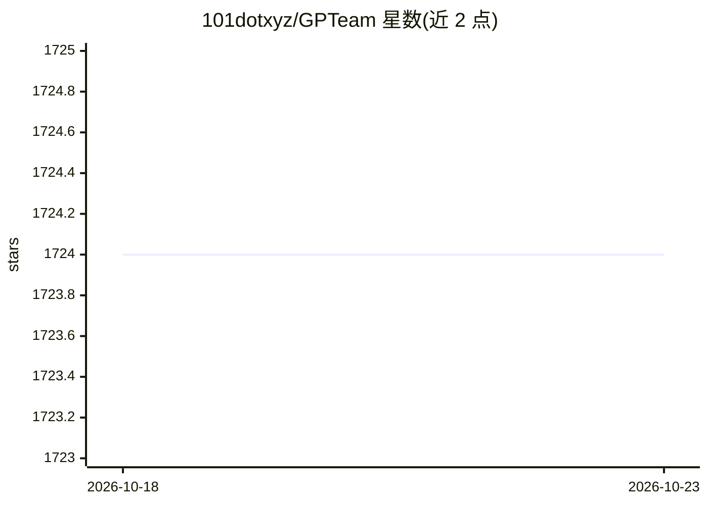

# 101dotxyz/GPTeam

⭐ 1,724 · Python · MIT · 推送 2026-10-15 · [GitHub](https://github.com/101dotxyz/GPTeam) · [官网](https://www.gpteamai.com/) · 个人维护

**基于 GPT-4 的多智能体协作模拟：多 agent 在世界中协作完成任务**

使用 GPT-4 创建多个智能体的开源模拟项目：每个 agent 配备记忆，通过对话相互沟通、在场景中移动并协作完成预设目标，用于探索 GPT 模型在多智能体生产力与沟通上的应用。通过克隆仓库、运行 setup.py、配置 OpenAI API key 后以 poetry 命令启动世界；支持 --turbo 用 gpt-3.5-turbo 降低成本，可切换 Claude 模型与 Discord 集成。MIT 许可。

## 筛选速览

| 维度 | 判定 | 备注 |
|---|---|---|
| AI 角色 | `ai-native` | 本体是模型或模型工具 |
| 许可风险 | `permissive` | MIT |
| 部署形态 | `None` |  |
| 模型依赖 | — | README 未给出锁定关系 |
| 硬件要求 | — | 无带数字的原话,不猜 |
| 安装摩擦 | `low` | 无编译、无系统依赖或容器化 |
| 成熟度 | — | 结构信号不足 |

## 能力要点

- 每个 agent 具备记忆与反思机制，通过沟通协作完成目标
- 支持 gpt-3.5-turbo 的低成本运行模式（--turbo）
- 可通过 config.json 自定义 agent 与场景地点
- 提供 Anthropic Claude 与 Discord 集成选项

## 适用场景

- 观察多智能体在模拟世界中的协作与沟通行为
- 实验不同 LLM 在多智能体任务中的表现
- 研究带记忆与反思机制的 agent 架构

## 场景标签

`多智能体` · 领域:Agent 开发

## 证据(README 行号)

> L11: GPTeam uses GPT-4 to create multiple agents who collaborate to achieve predefined goals. The main objective of this
> L33: GPTeam employs separate agents, each equipped with a memory, that interact with one another using communication as 

## 星数曲线

2026-10-18 1,724 → 2026-10-23 1,724（+0）

---
*卡片 v1 · prompt 1.4 · 生成 2026-10-21 · 置信度 high · 依据 README sha `97e66dc4364c` · [字段定义](../../DATASET.md)*
