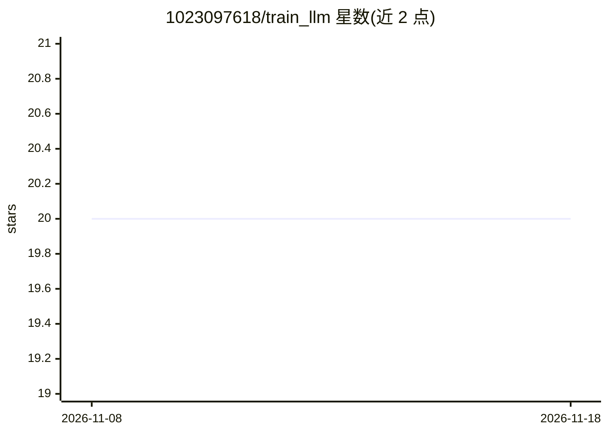

# 1023097618/train_llm

⭐ 20 · Python · 推送 2026-11-04 · [GitHub](https://github.com/1023097618/train_llm) · [官网](https://huggingface.co/zhvhabqifova/guangmingxing-d24) · 个人维护 · 中文 README

**从零训练小型聊天模型的完整流程：分词器到多模态**

复刻并扩展 nanochat 流程的个人项目：从 BPE 分词器起，依次完成预训练（FineWeb-Edu，约6.2B tokens）、SFT、带 KL 惩罚与动态采样的 RL（REINFORCE/GRPO），再到图像理解与对话式画图的多模态扩展。产出 0.78B 参数模型"Guangmingxing"，支持工具调用（hermes 格式），RL rollout 与评测用 vLLM。画图由 Z-Image-Turbo 完成、视觉用 SigLIP2、语音用 SenseVoice/Kokoro，模型本身负责对话与决策。权重与合成数据发布在 Hugging Face，中间阶段权重未发布；README 列出已知问题（算术出错、图片细节常错等）。

## 筛选速览

| 维度 | 判定 | 备注 |
|---|---|---|
| AI 角色 | `ai-native` | 本体是模型或模型工具 |
| 许可风险 | `none` | — |
| 部署形态 | `None` |  |
| 模型依赖 | local-ok | 支持本地模型 |
| 硬件要求 | — | 无带数字的原话,不猜 |
| 安装摩擦 | `medium` | 含编译或系统依赖之一 |
| 成熟度 | — | 结构信号不足 |

## 能力要点

- tokenizer→预训练→SFT→RL→多模态的完整训练管线（d24 达 CORE 0.248）
- 工具调用：计算器及 hermes 格式定义的任意工具
- 对话式画图：模型写出特殊 token，程序调用 Z-Image-Turbo 生成/修改图片并回填对话
- 最终模型与合成数据发布于 Hugging Face

## 适用场景

- 学习/复现从零训练聊天模型的完整流程
- 在两张 32GB GPU 上跑通预训练到 RL 的管线并生成报告
- 研究对话式图像生成与图像理解的小模型实现

## 场景标签

`模型训练` `强化学习` `多模态` `教程课程` · 领域:学习与行业

## 证据(README 行号)

> L5: From the tokenizer through pretraining and SFT to reinforcement learning, this trains a small chat model that can ca
> L10: The architecture, optimizer and training pipeline follow nanochat closely, with minimind
> L61: |Image understanding|`script/train_vlm.py`|frozen SigLIP2: first only the projector trains (align), then the chat m

## 星数曲线

2026-11-08 20 → 2026-11-18 20（+0）

---
*卡片 v1 · prompt 1.4 · 生成 2026-11-18 · 置信度 high · 依据 README sha `45393fcfa0cb` · [字段定义](../../DATASET.md)*
