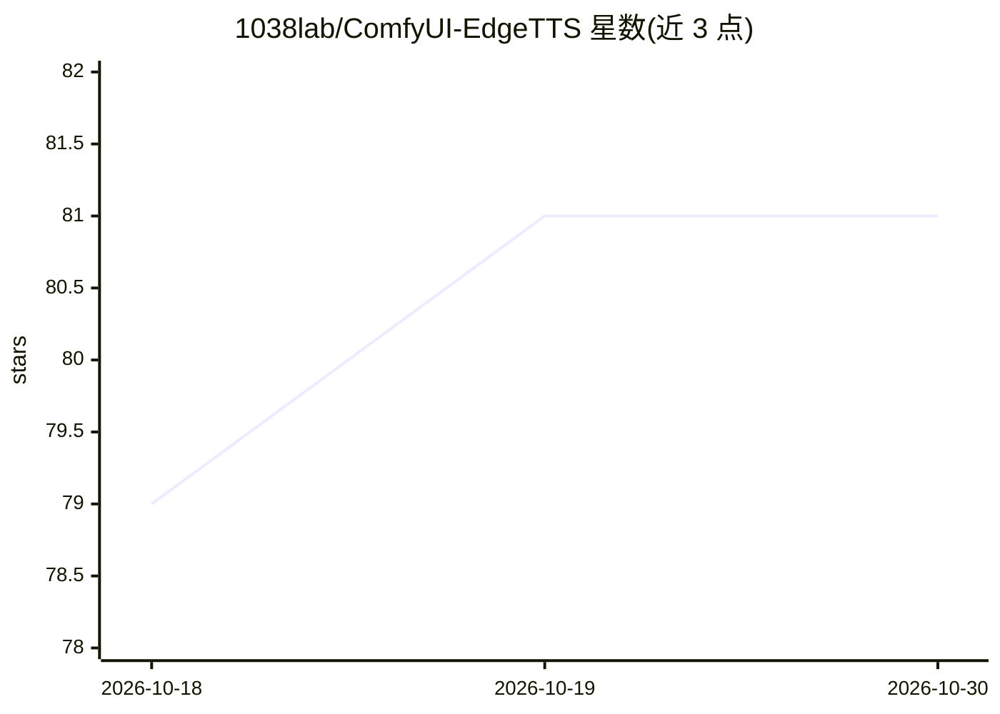

# 1038lab/ComfyUI-EdgeTTS

⭐ 81 · Python · GPL-3.0 · 推送 2026-10-13 · [GitHub](https://github.com/1038lab/ComfyUI-EdgeTTS) · 个人维护

**ComfyUI 的 TTS/STT 节点：文本转语音与语音转文字**

面向 ComfyUI 用户的自定义节点集：Edge TTS 节点调用微软 Edge TTS 将文本转换为多语言多音色语音，可调节语速与音调；Whisper STT 节点提供语音识别，支持 tiny 到 large 多档模型与自动语言检测，输出原始转写文本和带时间码的 SRT 字幕；另有 Save Audio 节点导出 WAV/MP3/FLAC。通过 ComfyUI-Manager 或克隆到 custom_nodes 目录安装，Whisper STT 需系统 PATH 中有 FFmpeg，CUDA GPU 为可选加速项。

## 筛选速览

| 维度 | 判定 | 备注 |
|---|---|---|
| AI 角色 | `ai-native` | 本体是模型或模型工具 |
| 许可风险 | `viral` | GPL-3.0 |
| 部署形态 | `library` | 以包/库形式分发 |
| 模型依赖 | — | README 未给出锁定关系 |
| 硬件要求 | — | 无带数字的原话,不猜 |
| 安装摩擦 | `medium` | 含编译或系统依赖之一 |
| 成熟度 | — | 结构信号不足 |

## 能力要点

- Edge TTS 文本转语音，多语言多音色，可调语速与音调
- Whisper STT 语音转文字，输出原文与时间码 SRT 字幕
- 音频导出支持 WAV/MP3/FLAC 及质量档位

## 适用场景

- 在 ComfyUI 工作流中把文本合成为语音
- 为视频/音频素材生成带时间码的字幕
- 将音频转写为文本供后续节点处理

## 场景标签

`语音合成` `语音识别` · 领域:内容生成

## 证据(README 行号)

> L21: - **Edge TTS**: Convert text to speech using Microsoft Edge TTS
> L28: - **Whisper STT**: High-accuracy speech recognition

## 星数曲线

2026-10-18 79 → 2026-10-30 81（+2）

---
*卡片 v1 · prompt 1.4 · 生成 2026-10-24 · 置信度 mid · 依据 README sha `1d076387257a` · [字段定义](../../DATASET.md)*
