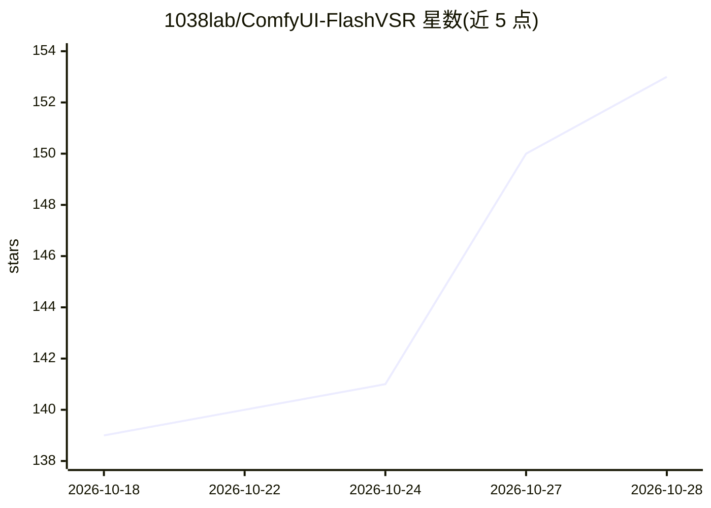

# 1038lab/ComfyUI-FlashVSR

⭐ 159 · Python · GPL-3.0 · 推送 2025-11-17 · [GitHub](https://github.com/1038lab/ComfyUI-FlashVSR) · 个人维护

**ComfyUI 自定义节点：基于 FlashVSR 模型做扩散视频超分**

面向 ComfyUI 用户的自定义节点，封装 FlashVSR V1.1 扩散模型，对图像帧序列执行 2x/4x 视频超分辨率，面向流媒体场景。提供 Full/Tiny/Tiny Long 三种模型档位，支持分块处理以降低显存占用、音频直通保持同步，首次运行自动从 Hugging Face 下载 safetensors 模型；可选安装 SageAttention 获得加速。通过 ComfyUI Manager、git clone 或 comfy-cli 安装，需配合视频加载/合成节点完成完整视频流程。

## 筛选速览

| 维度 | 判定 | 备注 |
|---|---|---|
| AI 角色 | `ai-native` | 本体是模型或模型工具 |
| 许可风险 | `viral` | GPL-3.0 |
| 部署形态 | `library` | 以包/库形式分发 |
| 模型依赖 | — | README 未给出锁定关系 |
| 硬件要求 | — | 无带数字的原话,不猜 |
| 安装摩擦 | `medium` | 含编译或系统依赖之一 |
| 成熟度 | — | 结构信号不足 |

## 能力要点

- 基于 FlashVSR 扩散模型的 2x/4x 视频超分辨率
- Full/Tiny/Tiny Long 三档模型与 enable_tiling 低显存分块处理
- 首次运行自动从 Hugging Face 下载 safetensors 模型
- 音频直通保持原视频音画同步

## 适用场景

- 在 ComfyUI 中对视频帧序列做超分辨率放大
- 低显存 GPU 上用分块与 Tiny Long 模型处理长视频
- 流媒体视频的高分辨率重建处理

## 场景标签

`图像视频处理` · 领域:感知与多模态

## 证据(README 行号)

> L3: A powerful ComfyUI custom node based on the FlashVSR model, enabling real-time diffusion-based video super-resolutio
> L8: **High-Quality Video Upscaling**: Utilizes the advanced FlashVSR model to upscale videos to 2x or 4x resolution.
> L104: **FlashVSR** is a real-time diffusion-based video super-resolution model. It is designed to provide high-quality u

## 星数曲线

2026-10-18 139 → 2026-10-28 153（+14）

---
*卡片 v1 · prompt 1.4 · 生成 2026-10-22 · 置信度 mid · 依据 README sha `d4142d228f28` · [字段定义](../../DATASET.md)*
