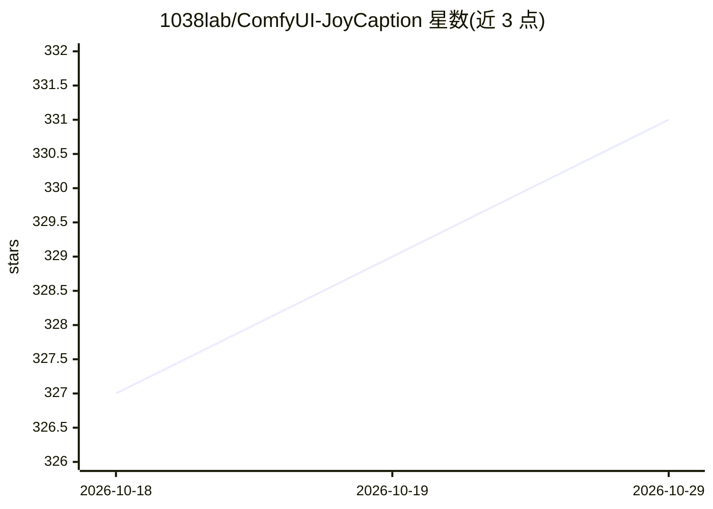

# 1038lab/ComfyUI-JoyCaption

⭐ 331 · Python · GPL-3.0 · 推送 2025-12-24 · [GitHub](https://github.com/1038lab/ComfyUI-JoyCaption) · 个人维护 · 中文 README

**ComfyUI 图像描述生成节点：LLaVA 模型产出风格化 caption**

基于 LLaVA 模型的 ComfyUI 自定义节点，为图像生成多种风格的 caption（描述、标签、技术、艺术等），支持长度控制与批量处理；Caption Tools 节点可从目录批量加载图片并将 caption 保存为文本文件。支持 HuggingFace 标准模型与 GGUF 量化模型（Q2_K 到 F16 共 12 档），通过 llama-cpp-python 运行，可切换 GPU/CPU 模式，模型首次使用时自动下载。安装方式为 git clone 到 custom_nodes 目录并 pip 安装依赖。

## 筛选速览

| 维度 | 判定 | 备注 |
|---|---|---|
| AI 角色 | `ai-native` | 本体是模型或模型工具 |
| 许可风险 | `viral` | GPL-3.0 |
| 部署形态 | `library` | 以包/库形式分发 |
| 模型依赖 | local-ok | 支持本地模型 |
| 硬件要求 | `gpu-8g` | |
| 安装摩擦 | `medium` | 含编译或系统依赖之一 |
| 成熟度 | — | 结构信号不足 |

## 能力要点

- LLaVA 模型生成 6 种风格 caption，长度可调
- GGUF 量化模型支持（Q2_K–F16 共 12 档）与 GPU/CPU 切换
- 批量图片加载与 caption 保存到文本文件的 Caption Tools 节点
- fp32/bf16/fp16/8-bit/4-bit 精度选项与内存管理模式

## 适用场景

- 为 Stable Diffusion 训练集批量生成图像 caption
- 低显存设备（6GB+）上用 GGUF 量化模型生成图像描述
- 在 ComfyUI 工作流中接入图像打标节点

## 场景标签

`图像视频处理` · 领域:感知与多模态

## 证据(README 行号)

> L3: Joy Caption is a ComfyUI custom node powered by the LLaVA model for efficient, stylized image captioning. Caption To
> L277: This implementation uses LLaVA-based image captioning models, optimized to provide fast and accurate image descrip

## 星数曲线

2026-10-18 327 → 2026-10-29 331（+4）

---
*卡片 v1 · prompt 1.4 · 生成 2026-10-21 · 置信度 mid · 依据 README sha `ee9bfa91a2e6` · [字段定义](../../DATASET.md)*
