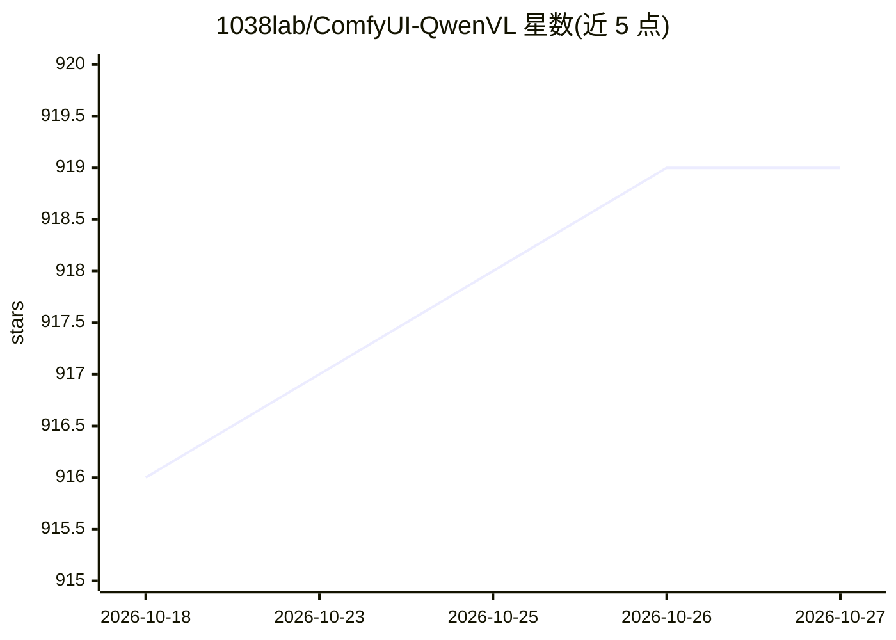

# 1038lab/ComfyUI-QwenVL

⭐ 919 · Python · GPL-3.0 · 推送 2026-09-14 · [GitHub](https://github.com/1038lab/ComfyUI-QwenVL) · 个人维护 · 中文 README

**ComfyUI 自定义节点：在 ComfyUI 中运行 Qwen-VL 视觉语言模型**

面向 ComfyUI 用户的自定义节点套件，将 Qwen-VL 系列（Qwen3-VL 2B-32B、Qwen3.5/3.6/3.8-VL、Qwen2.5-VL）接入工作流，提供图像理解、视频帧序列分析与文本提示增强。推理采用双引擎：Transformers (PyTorch，可选 SageAttention) 与 llama.cpp 的 GGUF 路径。模型首次使用时从 Hugging Face 自动下载，支持 4-bit/8-bit/FP16 量化、自定义模型 JSON 配置、视频 token 预算自动缩放以防上下文溢出与 CUDA OOM。通过 git clone 到 custom_nodes 目录并 pip 安装依赖完成部署。

## 筛选速览

| 维度 | 判定 | 备注 |
|---|---|---|
| AI 角色 | `ai-native` | 本体是模型或模型工具 |
| 许可风险 | `viral` | GPL-3.0 |
| 部署形态 | `library` | 以包/库形式分发 |
| 模型依赖 | local-ok | 支持本地模型 |
| 硬件要求 | `gpu-8g` | |
| 安装摩擦 | `medium` | 含编译或系统依赖之一 |
| 成熟度 | — | 结构信号不足 |

## 能力要点

- 覆盖 Qwen3-VL 至 Qwen3.8-VL 多规格模型的视觉语言推理节点
- Transformers 与 llama.cpp (GGUF) 双推理后端
- 视频输入的 token 预算自动估算与自动缩放，防止上下文溢出与 CUDA OOM
- custom_models.json 自定义模型扩展与 HuggingFace 模型自动下载

## 适用场景

- 在 ComfyUI 工作流中用 Qwen-VL 做图像理解或视频分析
- 用 Prompt Enhancer 节点改写文本提示
- GGUF 量化模型在本地显存受限环境下推理

## 场景标签

`多模态` · 领域:感知与多模态

## 证据(README 行号)

> L3: The ComfyUI-QwenVL suite brings Alibaba Cloud’s next-generation vision-language and reasoning models into ComfyUI. F
> L92: - **QwenVL**: Quick vision-language inference (image/video + preset/custom prompts).
> L100: - **QwenVL (GGUF)**: GGUF vision-language inference.

## 星数曲线

2026-10-18 916 → 2026-10-27 919（+3）

---
*卡片 v1 · prompt 1.4 · 生成 2026-10-21 · 置信度 mid · 依据 README sha `8d4bcc10ab0d` · [字段定义](../../DATASET.md)*
