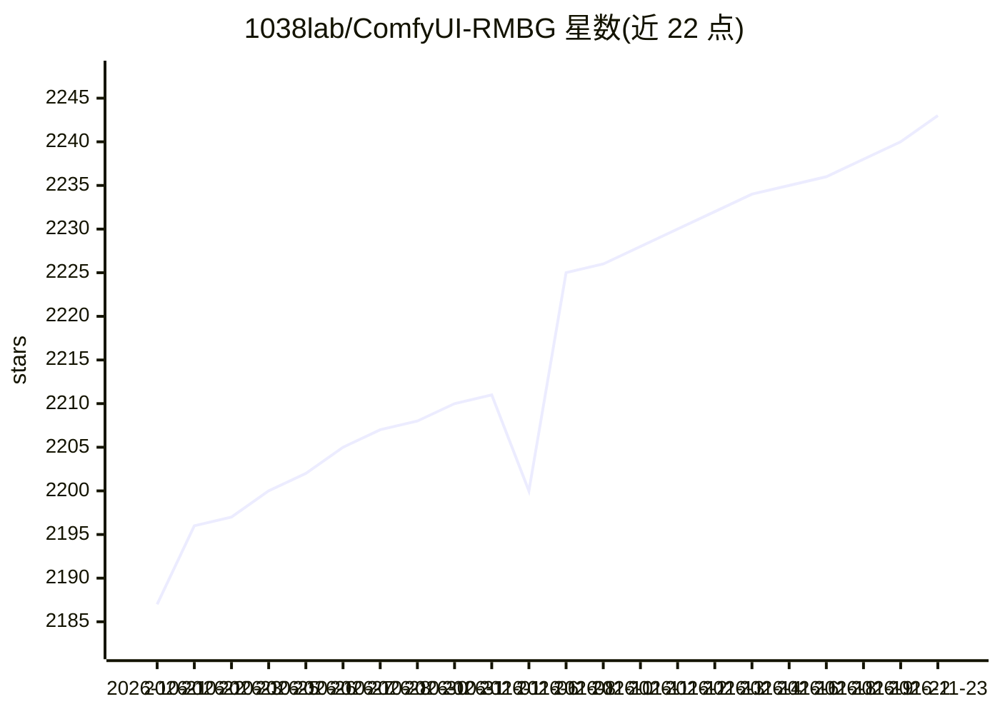

# 1038lab/ComfyUI-RMBG

⭐ 2,243 · Python · GPL-3.0 · 推送 2026-11-17 · [GitHub](https://github.com/1038lab/ComfyUI-RMBG) · [官网](https://1038lab.github.io/ComfyUI-RMBG/) · 个人维护

**ComfyUI 抠图与分割节点包：集成多模型去背景**

一个 ComfyUI 自定义节点集合，提供图像背景移除与对象、人脸、服装、时尚元素分割，集成 RMBG-2.0、BiRefNet、BEN2、SAM/SAM2/SAM3、Florence-2、YOLO、GroundingDINO 等多种模型。节点支持文本提示分割、批处理、视频抠图（VRMBG）、实时背景替换、边缘精修、首次使用自动下载模型及即时卸载释放显存。提供 ComfyUI-Manager、git clone、comfy-cli 三种安装方式，支持 macOS Apple Silicon（MPS）加速。

## 筛选速览

| 维度 | 判定 | 备注 |
|---|---|---|
| AI 角色 | `ai-native` | 本体是模型或模型工具 |
| 许可风险 | `viral` | GPL-3.0 |
| 部署形态 | `desktop` | 安装包/桌面程序 |
| 模型依赖 | — | README 未给出锁定关系 |
| 硬件要求 | — | 无带数字的原话,不猜 |
| 安装摩擦 | `low` | 无编译、无系统依赖或容器化 |
| 成熟度 | — | 结构信号不足 |

## 能力要点

- 集成 RMBG-2.0、BiRefNet、BEN2、SAM2/3、Florence-2、YOLO 等多种抠图与分割模型
- 文本提示分割，支持标签式与自然语言输入
- 首次使用自动下载模型，节点支持即时卸载释放显存
- 人脸 19 类、服装 18 类细分类别分割；支持 Apple Silicon MPS 加速

## 适用场景

- 在 ComfyUI 工作流中去掉图片背景并替换底色或透明输出
- 用文本提示在图中分割指定对象并裁剪导出
- 对人像按皮肤、眼睛、眉毛等特征做局部分割
- 对服装与配饰按类别批量抠图

## 场景标签

`目标检测` `图像视频处理` · 领域:感知与多模态

## 证据(README 行号)

> L3: A sophisticated ComfyUI custom node engineered for advanced image background removal and precise segmentation of obj
> L194: - Background Removal (RMBG Node)
> L216: ## Installation

## 星数曲线

2026-10-21 2,187 → 2026-11-23 2,243（+56）

---
*卡片 v1 · prompt 1.4 · 生成 2026-11-23 · 置信度 high · 依据 README sha `0787baa352d7` · [字段定义](../../DATASET.md)*
