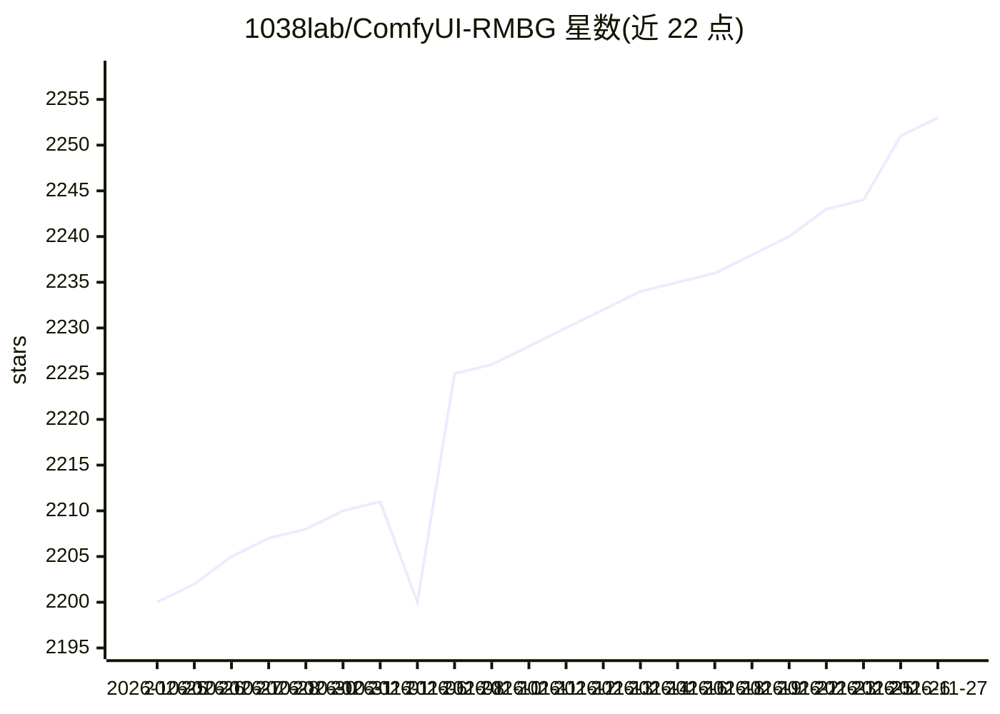

# 1038lab/ComfyUI-RMBG

⭐ 2,253 · Python · GPL-3.0 · 推送 2026-11-24 · [GitHub](https://github.com/1038lab/ComfyUI-RMBG) · [官网](https://1038lab.github.io/ComfyUI-RMBG/) · 个人维护

**ComfyUI 背景移除与分割自定义节点，集成多种分割模型**

作为 ComfyUI 自定义节点提供背景移除与图像分割能力，覆盖物体、人脸、服装与时尚元素分割，集成 RMBG-3.0/2.0、BiRefNet、SAM/SAM2/SAM3、Florence-2、YOLO 等模型。功能包括文本提示分割、实时背景替换、VRAM 即时卸载、批处理、视频背景移除与边缘精细化；模型在首次使用时自动下载，节点界面支持 7 种语言。安装经由 ComfyUI-Manager 或 pip 安装 requirements.txt，YOLO 节点需可选安装 ultralytics 包。

## 筛选速览

| 维度 | 判定 | 备注 |
|---|---|---|
| AI 角色 | `ai-native` | 本体是模型或模型工具 |
| 许可风险 | `viral` | GPL-3.0 |
| 部署形态 | `desktop` | 安装包/桌面程序 |
| 模型依赖 | — | README 未给出锁定关系 |
| 硬件要求 | — | 无带数字的原话,不猜 |
| 安装摩擦 | `low` | 无编译、无系统依赖或容器化 |
| 成熟度 | — | 结构信号不足 |

## 能力要点

- 集成 RMBG、BiRefNet、SAM/SAM2/SAM3、Florence-2、YOLO 等多类分割/去背景模型
- 支持标签与自然语言文本提示的物体分割（SAM 与 GroundingDINO）
- 节点界面提供 7 种语言翻译，模型首次使用时自动下载
- 支持批量处理、VRAM 即时卸载与 Apple Silicon (MPS) 加速

## 适用场景

- 在 ComfyUI 工作流中批量去除图片背景并输出透明通道
- 用文本提示从图像中分割指定物体、人脸或服装类别
- 对视频序列做逐帧去背景抠像
- 生成 Soft Creature/服装分割蒙版用于后续图像处理流程

## 场景标签

`图像视频处理` `目标检测` · 领域:感知与多模态

## 证据(README 行号)

> L3: A sophisticated ComfyUI custom node engineered for advanced image background removal and precise segmentation of obj
> L202: - Background Removal (RMBG & RMBG-3.0 Nodes)
> L229: ### Method 1. install on ComfyUI-Manager, search `Comfyui-RMBG` and install

## 星数曲线

2026-10-25 2,200 → 2026-11-27 2,253（+53）

---
*卡片 v1 · prompt 1.4 · 生成 2026-11-24 · 置信度 high · 依据 README sha `44caa81fbd6a` · [字段定义](../../DATASET.md)*
