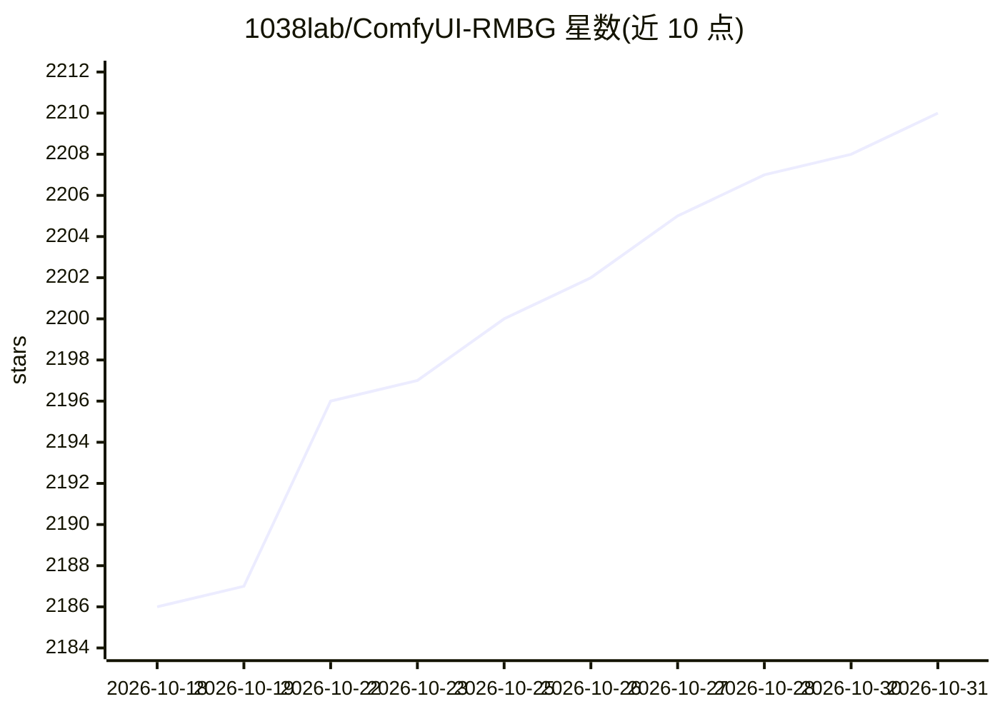

# 1038lab/ComfyUI-RMBG

⭐ 2,210 · Python · GPL-3.0 · 推送 2026-10-20 · [GitHub](https://github.com/1038lab/ComfyUI-RMBG) · [官网](https://1038lab.github.io/ComfyUI-RMBG/) · 个人维护

**ComfyUI 图像抠图与分割节点集，覆盖背景移除和人脸/服装分割**

面向 ComfyUI 用户的自定义节点集合，提供背景移除（RMBG-2.0、INSPYRENET、BEN、BEN2）、文本提示物体分割（SAM/SAM2/SAM3、GroundingDINO）、人脸 19 类特征分割、服装 18 类分割与时尚配饰分割，以及掩码/图像处理工具节点。支持批量处理、RGBA 输出、实时背景替换、即时释放显存的 unload_model 开关、Apple Silicon MPS 加速与多语言界面。模型首次使用时自动下载，也可手动放置到 models 目录；通过 ComfyUI-Manager、git clone 或 comfy CLI 安装后需装 requirements.txt，YOLO 节点需可选安装 ultralytics。

## 筛选速览

| 维度 | 判定 | 备注 |
|---|---|---|
| AI 角色 | `ai-native` | 本体是模型或模型工具 |
| 许可风险 | `viral` | GPL-3.0 |
| 部署形态 | `desktop` | 安装包/桌面程序 |
| 模型依赖 | — | README 未给出锁定关系 |
| 硬件要求 | — | 无带数字的原话,不猜 |
| 安装摩擦 | `low` | 无编译、无系统依赖或容器化 |
| 成熟度 | — | 结构信号不足 |

## 能力要点

- 背景移除多模型：RMBG-2.0/INSPYRENET/BEN/BEN2/BiRefNet 等
- 文本提示分割（标签或自然语言）基于 SAM/SAM2/SAM3 与 GroundingDINO
- 人脸 19 类、服装 18 类、时尚配饰专用分割节点
- 模型首次使用自动下载，unload_model 开关即时释放显存

## 适用场景

- 在 ComfyUI 工作流中给图片去背景并输出透明通道
- 用文字提示分割指定物体或人物部位
- 对人脸五官、服装品类做细粒度抠图

## 场景标签

`图像视频处理` `目标检测` · 领域:感知与多模态

## 证据(README 行号)

> L3: A sophisticated ComfyUI custom node engineered for advanced image background removal and precise segmentation of obj
> L184: - Background Removal (RMBG Node)
> L190:  - Text-prompted object detection

## 星数曲线

2026-10-18 2,186 → 2026-10-31 2,210（+24）

---
*卡片 v1 · prompt 1.4 · 生成 2026-10-21 · 置信度 mid · 依据 README sha `e281d9d396d0` · [字段定义](../../DATASET.md)*
