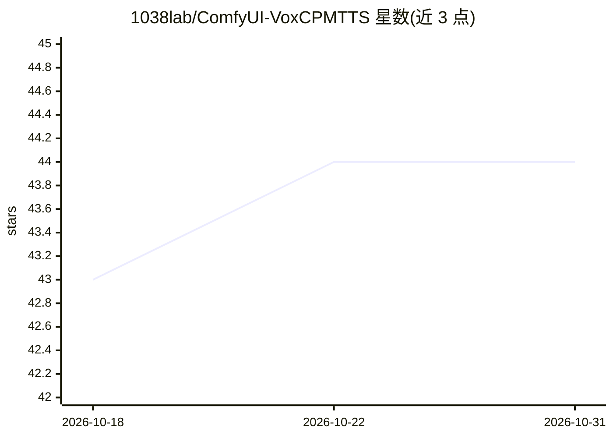

# 1038lab/ComfyUI-VoxCPMTTS

⭐ 44 · Python · GPL-3.0 · 推送 2025-12-11 · [GitHub](https://github.com/1038lab/ComfyUI-VoxCPMTTS) · 个人维护

**为 ComfyUI 提供 VoxCPM 文本转语音与声音克隆的自定义节点**

ComfyUI 自定义节点，封装 OpenBMB 的 VoxCPM1.5 TTS 模型（约 500M 参数、16kHz 采样率、Apache 2.0），从文本生成语音，并支持基于参考音频的声音克隆；参考文本留空时用 faster-whisper 自动转写。支持 CUDA/MPS/CPU 设备选择，可调 cfg_value、推理步数等参数，内置淡入后处理。模型（约 1.2GB）首次使用时自动从 Hugging Face 下载。面向使用 ComfyUI 工作流的开发者与创作者。

## 筛选速览

| 维度 | 判定 | 备注 |
|---|---|---|
| AI 角色 | `ai-native` | 本体是模型或模型工具 |
| 许可风险 | `viral` | GPL-3.0 |
| 部署形态 | `library` | 以包/库形式分发 |
| 模型依赖 | — | README 未给出锁定关系 |
| 硬件要求 | — | 无带数字的原话,不猜 |
| 安装摩擦 | `medium` | 含编译或系统依赖之一 |
| 成熟度 | — | 结构信号不足 |

## 能力要点

- 文本转语音与参考音频声音克隆
- 参考音频自动转写（faster-whisper，可选模型大小）
- CUDA/MPS/CPU 多设备支持与自动设备选择
- 模型首次使用时自动下载到 ComfyUI/models/TTS 目录

## 适用场景

- 在 ComfyUI 工作流中用文本生成语音
- 用参考音频样本克隆特定音色
- 批量文本转语音并保存音频

## 场景标签

`语音合成` · 领域:内容生成

## 证据(README 行号)

> L3: A clean, efficient ComfyUI custom node for VoxCPMTTS (Text-to-Speech) functionality. This implementation provides hi
> L9: - 🎯 **High-Quality TTS**: Generate natural-sounding speech from text
> L10: - 🎭 **Voice Cloning**: Clone any voice using a reference audio sample

## 星数曲线

2026-10-18 43 → 2026-10-31 44（+1）

---
*卡片 v1 · prompt 1.4 · 生成 2026-10-25 · 置信度 mid · 依据 README sha `b185fe093fcf` · [字段定义](../../DATASET.md)*
