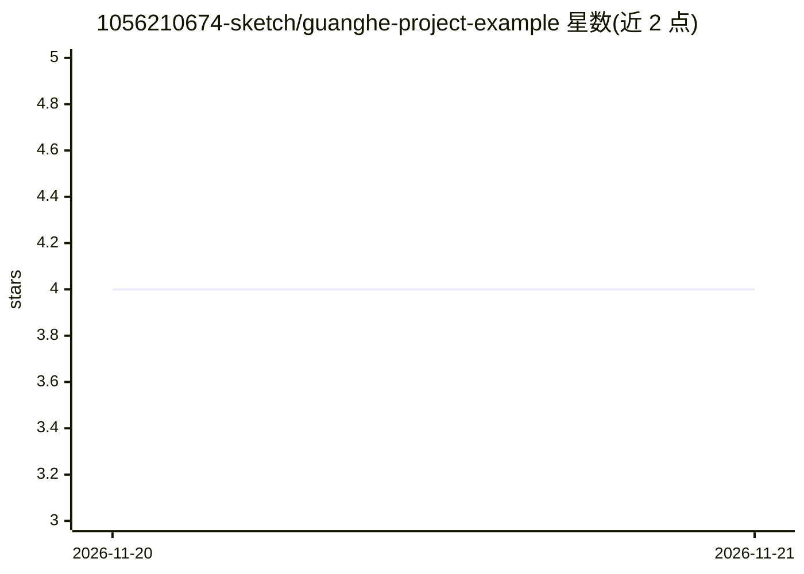

# 1056210674-sketch/guanghe-project-example

⭐ 4 · Java · MIT · 推送 2026-11-18 · [GitHub](https://github.com/1056210674-sketch/guanghe-project-example) · [官网](https://www.guangheai.com/) · 组织维护 · 中文 README

**企业级全栈 AI Agent 框架：对话、知识、内容创作与 GEO 监测**

由公司提供的完整源码项目，包含 React Web 前端、Java 业务控制面与 Python 智能执行面三端。Java 负责鉴权、数据归属、任务准入与积分计费，Python 负责 Agent 循环、模型与工具调用及异步 Worker，二者通过版本化契约（OpenAPI/SSE/RabbitMQ Schema）交互。覆盖智能体对话、品牌知识库、GEO 监测诊断、文章与图片视频创作、内容投稿等模块。源码快照非免配置 SaaS，需自备数据库、中间件与供应商服务，部分能力可能单独计费。

## 筛选速览

| 维度 | 判定 | 备注 |
|---|---|---|
| AI 角色 | `ai-ecosystem` | LLM/agent 周边工具 |
| 许可风险 | `permissive` | MIT |
| 部署形态 | `None` |  |
| 模型依赖 | locked-api |  |
| 硬件要求 | — | 无带数字的原话,不猜 |
| 安装摩擦 | `medium` | 含编译或系统依赖之一 |
| 成熟度 | — | 结构信号不足 |

## 能力要点

- 三端架构：Java 业务控制与 Python 智能执行分离，业务数据库唯一写入方为 Java
- 有界智能执行：工具白名单、预算与超时限制、异步任务闭环
- GEO 品牌监测：采样任务、竞品、报告解读与 PDF 导出
- Python 本地确定性模式可在不调用真实模型的情况下探索运行流程

## 适用场景

- 研究从消息发送到异步任务完成的全链路工程实现
- 构建带身份、项目隔离、工具权限与预算控制的智能体应用
- 品牌团队搭建知识、内容生产与 AI 搜索可见度监测工作流

## 场景标签

`Agent 框架` `聊天机器人` `知识库管理` `AI 写作` · 领域:Agent 开发

## 证据(README 行号)

> L23: **光禾AI智能体框架**由 **广州光禾未来人工智能科技有限公司（光禾AI / GUANGHE AI）** 提供，是一个包含 React Web、Java 业务控制面和 Python 智能执行面的完整源码项目。
> L72: |Python|有界 Agent 循环、Provider 适配、模型与工具调用、长任务执行|不直接写业务 PostgreSQL，不决定积分或任务业务终态|
> L83: 当前 Python 普通对话使用项目自有的原生 Agent Loop，不依赖 LangChain / LangGraph。

## 星数曲线

2026-11-20 4 → 2026-11-21 4（+0）

---
*卡片 v1 · prompt 1.4 · 生成 2026-11-21 · 置信度 high · 依据 README sha `8c37355c7f6d` · [字段定义](../../DATASET.md)*
