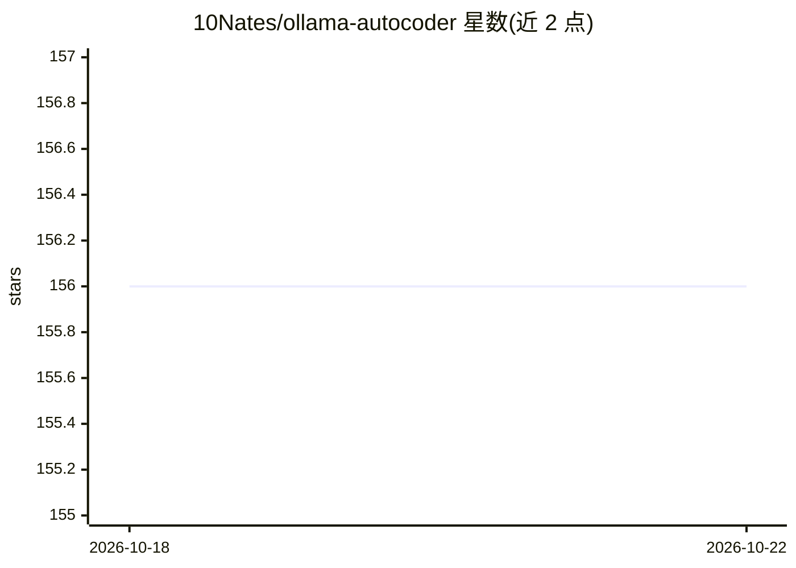

# 10Nates/ollama-autocoder

⭐ 156 · TypeScript · MIT · 推送 2026-10-21 · [GitHub](https://github.com/10Nates/ollama-autocoder) · 个人维护

**调用 Ollama 的 VSCode 代码自动补全扩展**

VSCode 扩展，通过本地 Ollama API 端点生成代码补全：按键或命令面板触发后 token 流式插入到光标处，可中途取消。要求 Ollama 已运行并安装设置中指定的模型（默认 qwen2.5-coder:latest），提示窗口仅读取光标之前的文本。设置项暴露补全触发键、响应预览、预览延迟、continue inline 等选项；说明中提到 Nvidia GPU 或 Apple Silicon 可获得更快速度，CPU 仍可运行小模型。

## 筛选速览

| 维度 | 判定 | 备注 |
|---|---|---|
| AI 角色 | `ai-ecosystem` | LLM/agent 周边工具 |
| 许可风险 | `permissive` | MIT |
| 部署形态 | `None` |  |
| 模型依赖 | local-ok | 支持本地模型 |
| 硬件要求 | — | 无带数字的原话,不猜 |
| 安装摩擦 | `low` | 无编译、无系统依赖或容器化 |
| 成熟度 | — | 结构信号不足 |

## 能力要点

- 补全 token 流式输出到光标处
- 通过命令面板、快捷键或补全触发键启动生成
- 可配置补全触发键、响应预览、预览延迟、continue inline 等选项
- 生成可中途取消（通知按钮或继续输入）

## 适用场景

- 在 VSCode 中用本地 Ollama 模型做代码补全
- 离线/本地环境下的行内代码生成
- 按硬件情况调整预览行为以适配低配或电池设备

## 场景标签

`代码生成` · 领域:编码与开发

## 证据(README 行号)

> L3: A simple to use Ollama autocompletion engine with options exposed and streaming functionality
> L9: - Ollama must be serving on the API endpoint applied in settings

## 星数曲线

2026-10-18 156 → 2026-10-22 156（+0）

---
*卡片 v1 · prompt 1.4 · 生成 2026-10-22 · 置信度 high · 依据 README sha `81e948fb5f13` · [字段定义](../../DATASET.md)*
