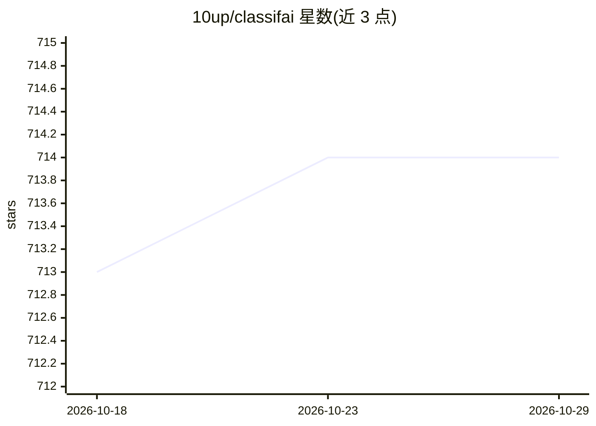

# 10up/classifai

⭐ 714 · PHP · GPL-2.0 · 推送 2026-10-22 · [GitHub](https://github.com/10up/classifai) · [官网](https://classifaiplugin.com) · 组织维护

**WordPress 插件：用 AI 自动生成摘要/标题/图片/转录并分类内容**

10up 维护的 WordPress 插件，接入 OpenAI、Microsoft Azure AI、Google Gemini、IBM Watson、xAI、Together AI 等云服务以及本地 Ollama/Stable Diffusion，为 WordPress 站点提供内容工作流自动化：生成摘要、标题、要点、扩写/缩写、全文草稿、图片生成与替换文本、音频转录与文字转语音、评论审核、内容分类与推荐，支持 WP-CLI 批量分类与本地 LLM 部署，通过内置 filter 用环境变量管理凭证。要求 PHP 7.4+ 与 WordPress 6.9+，各功能可能有各自的依赖。

## 筛选速览

| 维度 | 判定 | 备注 |
|---|---|---|
| AI 角色 | `ai-native` | 本体是模型或模型工具 |
| 许可风险 | `viral` | GPL-2.0 |
| 部署形态 | `library` | 以包/库形式分发 |
| 模型依赖 | local-ok | 支持本地模型 |
| 硬件要求 | — | 无带数字的原话,不猜 |
| 安装摩擦 | `low` | 无编译、无系统依赖或容器化 |
| 成熟度 | — | 结构信号不足 |

## 能力要点

- 摘要/标题/要点/文章草稿/扩写缩写等文本生成，支持多种云 API 与本地 Ollama
- 图像处理：按需生成图片、替换文本、智能裁剪、标签提取、PDF 文本扫描
- 音频转录与文字转语音（read-to-me 前端播放）、评论敏感内容审核
- WP-CLI 批量分类、robots.txt 屏蔽 AI 爬虫、本地 LLM 部署、凭证外置管理

## 适用场景

- 我为 WordPress 站点自动生成摘要、标题和标签，减少编辑工作
- 我用本地 Ollama 或 Stable Diffusion 在不外发数据的前提下使用 AI 功能
- 我给图片批量生成替换文本、给音频生成转录并加上朗读功能

## 场景标签

`工作流自动化` `图像生成` `图像视频处理` `AI 写作` · 领域:效率与自动化

## 证据(README 行号)

> L15: Tap into leading cloud-based services like OpenAI, Microsoft Azure AI, Google Gemini and IBM Watson to augment your
> L19: * Generate a summary of post content and store it as an excerpt using OpenAI's ChatGPT API, Microsoft Azure's OpenA

## 星数曲线

2026-10-18 713 → 2026-10-29 714（+1）

---
*卡片 v1 · prompt 1.4 · 生成 2026-10-21 · 置信度 mid · 依据 README sha `b959ce8977ae` · [字段定义](../../DATASET.md)*
