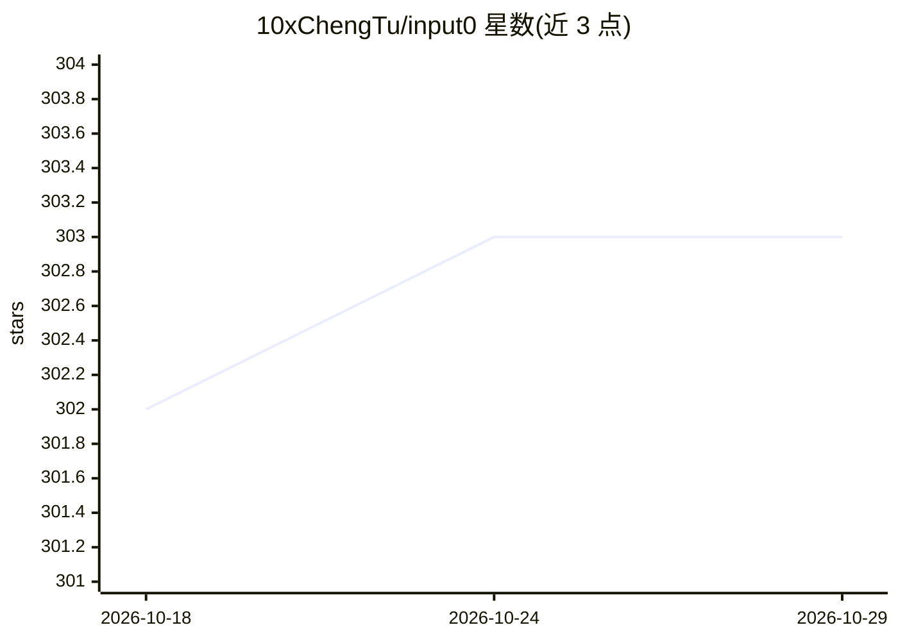

# 10xChengTu/input0

⭐ 303 · Rust · NOASSERTION · 推送 2026-05-28 · [GitHub](https://github.com/10xChengTu/input0) · [官网](https://input0.com) · 个人维护 · 中文 README

**macOS 语音输入工具：按住热键说话，本地转写加 LLM 润色后自动粘贴**

面向 macOS 用户的语音输入应用：按住热键（默认 Option+Space）录音，松开后由本地 STT 引擎转写（Whisper、SenseVoice、Paraformer、Moonshine、FireRedASR、Zipformer CTC 六引擎，经 Metal GPU 在本机运行），再调用 OpenAI 兼容 API 的 LLM 修正语法、去除语气词并结构化文本，最后自动粘贴到当前输入框。支持 99+ 语言、按需下载模型、自定义词汇与历史记录。要求 macOS 11.0+，LLM 润色需自行配置 API key，无 key 时仅跳过润色。以 .dmg 安装包与 Homebrew 分发。

## 筛选速览

| 维度 | 判定 | 备注 |
|---|---|---|
| AI 角色 | `ai-native` | 本体是模型或模型工具 |
| 许可风险 | `none` | NOASSERTION |
| 部署形态 | `desktop` | 安装包/桌面程序 |
| 模型依赖 | — | README 未给出锁定关系 |
| 硬件要求 | — | 无带数字的原话,不猜 |
| 安装摩擦 | `low` | 无编译、无系统依赖或容器化 |
| 成熟度 | — | 结构信号不足 |

## 能力要点

- 六种本地 STT 引擎共 12 个模型可选，音频不离开设备
- LLM 润色：语法修正、去语气词、专业术语纠正与自定义词汇
- 转写结果自动粘贴到任意应用的输入框
- 支持 99+ 语言并按语言推荐模型

## 适用场景

- 在聊天、编辑器、浏览器等任意输入框用语音快速输入文字
- 中文或中英混说场景获得整理后的规范文本
- 隐私敏感、不愿音频上云的本地语音转写

## 场景标签

`语音识别` · 领域:感知与多模态

## 证据(README 行号)

> L10: Local AI transcription → LLM text optimization → auto-paste. Private, fast, effortless.
> L17: - **Privacy-First Local STT** — Six AI engines (Whisper, SenseVoice, Paraformer, Moonshine, FireRedASR, Zipformer C

## 星数曲线

2026-10-18 302 → 2026-10-29 303（+1）

---
*卡片 v1 · prompt 1.4 · 生成 2026-10-22 · 置信度 high · 依据 README sha `7602f62f98af` · [字段定义](../../DATASET.md)*
