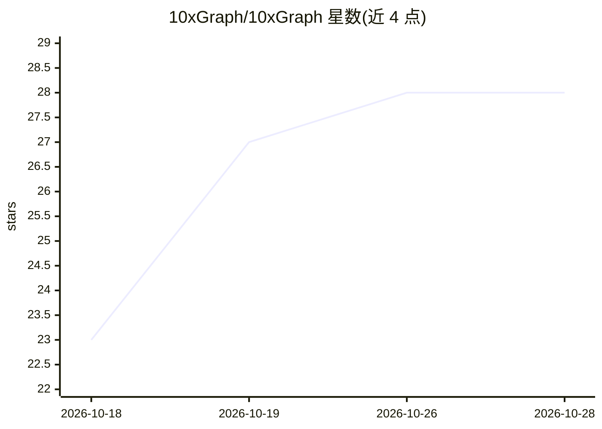

# 10xGraph/10xGraph

⭐ 28 · Python · MIT · 推送 2026-10-27 · [GitHub](https://github.com/10xGraph/10xGraph) · [官网](https://10xgraph.com) · 组织维护

**构建多 agent AI 系统的 Python 图编排框架，面向生产部署**

开源 Python 框架（原 Agentflow，更名而来），以节点与工具的图结构编写 agent：运行循环持久化当前节点并记录工具调用台账，崩溃后重试不会重复执行已完成的工具调用；状态写入采用版本化乐观并发控制，支持节点/工具超时与 interrupt() 人工审批。`10xgraph-api` 包从图生成生产服务器（REST/SSE/WebSocket、JWT 认证、限流、Docker/K8s 文件），另有 TypeScript 客户端与 React Playground。持久化为 Redis 缓存 + PostgreSQL 两级，长期记忆接 Qdrant/Mem0，事件可发布至 Kafka/RabbitMQ 等。模型接入 OpenAI/OpenAI 兼容端点、Google Gemini、Anthropic（含 Vertex/Bedrock）。自述社区与集成少于 LangGraph/CrewAI。

## 筛选速览

| 维度 | 判定 | 备注 |
|---|---|---|
| AI 角色 | `ai-ecosystem` | LLM/agent 周边工具 |
| 许可风险 | `permissive` | MIT |
| 部署形态 | `self-host` | docker 或自建部署 |
| 模型依赖 | locked-api |  |
| 硬件要求 | — | 无带数字的原话,不猜 |
| 安装摩擦 | `low` | 无编译、无系统依赖或容器化 |
| 成熟度 | — | 结构信号不足 |

## 能力要点

- 工具调用台账使崩溃重试不重复执行已完成的工具
- 10xgraph-api 从图生成 REST/SSE/WebSocket 生产服务器及 Docker/K8s 部署文件
- 两级持久化：Redis 缓存 + PostgreSQL 版本化写入，支持 Qdrant/Mem0 长期记忆
- 内置 React/RAG/Swarm/SupervisorTeam 等预置 agent 与实时语音 agent

## 适用场景

- Python 团队将 agent 从原型推向生产（认证、持久化、部署一键生成）
- 运行带副作用的 agent（支付、邮件），防止重试导致重复执行
- 多用户自托管 AI 产品，需要线程隔离与限流
- 需要实时语音对话或 MCP 工具集成的多 agent 编排

## 场景标签

`Agent 框架` `多智能体` · 领域:Agent 开发

## 证据(README 行号)

> L11: 10xGraph is an open-source Python framework for building multi-agent AI systems and running them in production. You
> L46: **Also included** (standard for agent frameworks, listed as facts): graph orchestration and the ReAct tool-calling 

## 星数曲线

2026-10-18 23 → 2026-10-28 28（+5）

---
*卡片 v1 · prompt 1.4 · 生成 2026-10-26 · 置信度 high · 依据 README sha `648dc5098dc5` · [字段定义](../../DATASET.md)*
