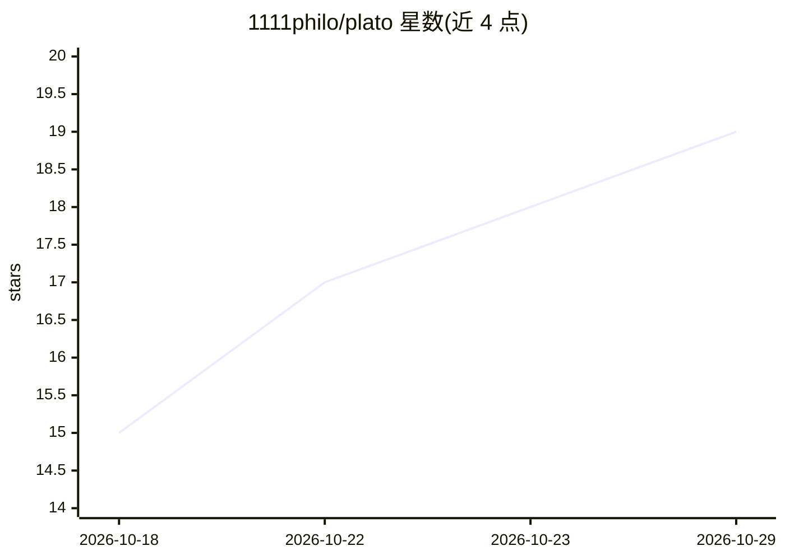

# 1111philo/plato

⭐ 19 · JavaScript · NOASSERTION · 推送 2026-10-27 · [GitHub](https://github.com/1111philo/plato) · [官网](https://philosophers.group/plato-agentic-classroom/) · 组织维护

**开源 AI 微学习平台：AI 教练对话式带学习者完成示范式课程**

面向学习者与教育管理者的微学习平台（AGPL-3.0）。每节课围绕一个示范成果与 2-4 个学习目标，AI 教练在单次连续对话中创建活动、批改文本/图片提交并追踪掌握进度，目标 11 轮交互（约 20 分钟）内完成。管理后台提供 On-Target Rate 与学习者参与度 KPI、课堂定制器与插件系统。后端为 Node.js + Hono + Lambda + DynamoDB，模型仅通过 Amazon Bedrock 运行 Qwen3-VL 235B（Apache-2.0），需 AWS 凭证才能开始课程对话；无凭证时应用可浏览。

## 筛选速览

| 维度 | 判定 | 备注 |
|---|---|---|
| AI 角色 | `ai-native` | 本体是模型或模型工具 |
| 许可风险 | `none` | NOASSERTION |
| 部署形态 | `None` |  |
| 模型依赖 | locked-api |  |
| 硬件要求 | — | 无带数字的原话,不猜 |
| 安装摩擦 | `low` | 无编译、无系统依赖或容器化 |
| 成熟度 | — | 结构信号不足 |

## 能力要点

- AI 教练在连续对话中创建任务、批改提交并追踪掌握进度
- 微学习节奏设计：11 轮交互目标，教练按轮次自适应策略，不强制截断
- 管理后台提供 On-Target Rate 与学习者参与度 KPI
- 插件系统支持添加 AI agent、管理页面、服务端路由等扩展

## 适用场景

- 学习者通过对话完成聚焦的示范式微课程
- 教师/管理员管理课程、用户与知识库并查看 KPI
- 通过插件扩展平台功能（自定义字段、AI agent 等）

## 场景标签

 · 领域:教育/学习平台

## 证据(README 行号)

> L5: An Open Source, AI-powered microlearning platform. Learners work through focused, exemplar-driven lessons in a conti
> L17: A **lesson** defines an exemplar (the mastery-level outcome a learner produces) and a set of learning objectives. W
> L76: plato runs a single **open source** model on Amazon Bedrock — [Qwen3-VL 235B

## 星数曲线

2026-10-18 15 → 2026-10-29 19（+4）

---
*卡片 v1 · prompt 1.4 · 生成 2026-10-29 · 置信度 high · 依据 README sha `9ef4ef379a75` · [字段定义](../../DATASET.md)*
