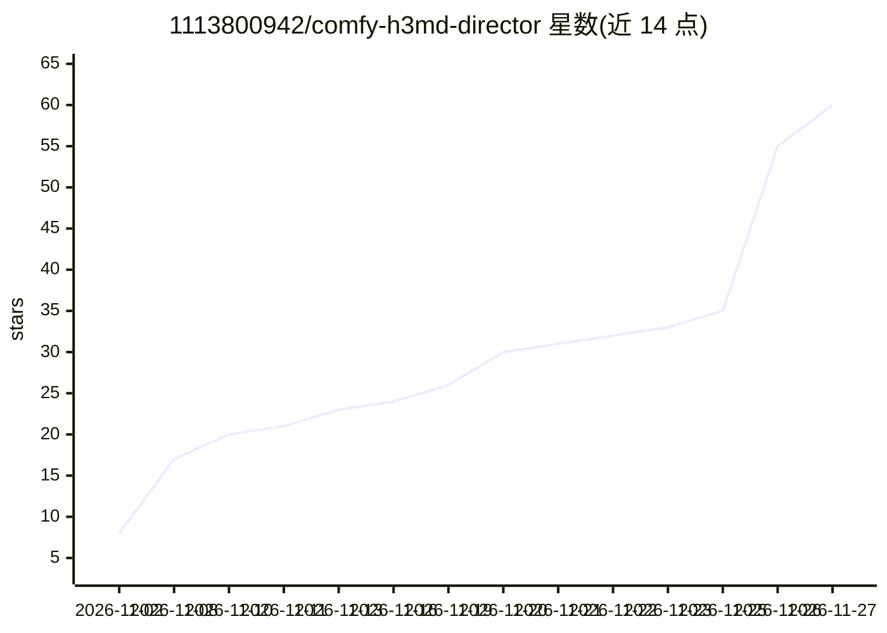

# 1113800942/comfy-h3md-director

⭐ 60 · Python · AGPL-3.0 · 推送 2026-11-26 · [GitHub](https://github.com/1113800942/comfy-h3md-director) · [官网](https://registry.comfy.org/nodes/comfyui-h3md-director) · 个人维护 · 中文 README

**ComfyUI 节点集：用 MiniMax H3 一次生成 2 分钟以上多镜头长视频**

以 ComfyUI 自定义节点形式提供的长视频生成工具集：通过可视化 Director 规划分镜，配合 Chained Context Windows（CCW）将延续镜头在同一时间线上按时间顺序渲染，避免接缝、重影与色彩漂移；支持按秒级范围局部重绘、整段重跑、缓存续跑、动作参考视频（depth+SAM3+Fun ControlNet）驱动运动，以及锁定歌曲的口型同步音乐视频。不含 MiniMax H3 权重，需自行获取符合其许可证的模型；硬件要求 40/50 系列 GPU，16 GB VRAM 起步、建议 24 GB 以上。

## 筛选速览

| 维度 | 判定 | 备注 |
|---|---|---|
| AI 角色 | `ai-native` | 本体是模型或模型工具 |
| 许可风险 | `viral` | AGPL-3.0 |
| 部署形态 | `library` | 以包/库形式分发 |
| 模型依赖 | — | README 未给出锁定关系 |
| 硬件要求 | `gpu-8g` | |
| 安装摩擦 | `medium` | 含编译或系统依赖之一 |
| 成熟度 | — | 结构信号不足 |

## 能力要点

- CCW 链式上下文窗口：延续镜头单时间线渲染，无接缝与色彩漂移
- Redraw/Preview 节点只重绘指定秒数，缓存续跑帧级一致
- 动作复制：参考视频经 depth+SAM3+Fun ControlNet 驱动运动
- 按 VRAM 自动分块、高分辨率条带平铺与磁盘缓存

## 适用场景

- 一次运行生成 2 分钟以上的 1080p 多镜头短片
- 用照片与参考视频做动作复制视频
- 制作与固定歌曲口型同步的音乐视频
- 成片后只修复出错几秒而不整片重渲

## 场景标签

`视频生成` · 领域:内容生成

## 证据(README 行号)

> L5: Long, multi-shot MiniMax H3 video in ComfyUI — **2+ minutes at 1080p in one run**. Plan shots in a visual Director;
> L9: > H3MD does **not** include any MiniMax H3 weights; the model has its own license (see NOTICE.md).
> L24: - **Long video in one run**: 2–3 minutes at 1080p (measured: a 2 min 20 s music video at 1920×1088 in 2 h 18 min on

## 星数曲线

2026-11-02 8 → 2026-11-27 60（+52）

---
*卡片 v1 · prompt 1.4 · 生成 2026-11-18 · 置信度 mid · 依据 README sha `ffa3eeb9d692` · [字段定义](../../DATASET.md)*
