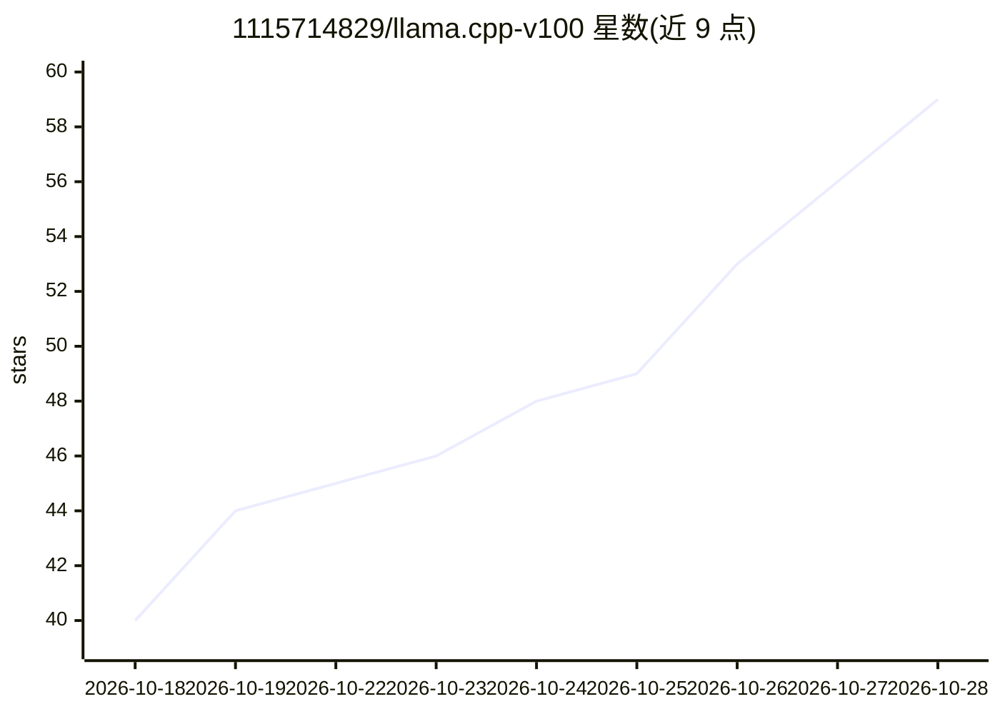

# 1115714829/llama.cpp-v100

⭐ 61 · C++ · GPL-3.0 · 推送 2026-10-23 · [GitHub](https://github.com/1115714829/llama.cpp-v100) · 个人维护 · 中文 README

**面向 NVIDIA V100 的 llama.cpp 优化推理运行环境**

基于 llama.cpp（上游 v0.6.0）修改的推理运行环境，只优化底层框架（计算内核、多卡并行、调度与投机解码链路），不修改量化模型。面向 NVIDIA Tesla V100（SM70）用户，支持 2-6 卡协同、26 万-52 万上下文、多路并发、多模态（mmproj）、DFlash2 与 MTP 投机解码，适配 Qwen3.8-27B 与 Qwen3.8-Flash-Next；提供 x86_64 Linux 预编译程序、源码编译与含 web UI 的 Docker 镜像，同一镜像覆盖 x86_64 与 IBM Power AC922（ppc64le）。限制：需 V100 显卡与 NVIDIA 驱动 550+。

## 筛选速览

| 维度 | 判定 | 备注 |
|---|---|---|
| AI 角色 | `ai-ecosystem` | LLM/agent 周边工具 |
| 许可风险 | `viral` | GPL-3.0 |
| 部署形态 | `self-host` | docker 或自建部署 |
| 模型依赖 | — | README 未给出锁定关系 |
| 硬件要求 | `gpu-8g` | |
| 安装摩擦 | `low` | 无编译、无系统依赖或容器化 |
| 成熟度 | — | 结构信号不足 |

## 能力要点

- 2-6 卡 V100 多卡并行与 26 万-52 万长上下文支持
- DFlash2 / MTP 投机解码完整链路实现
- 多模态模块（mmproj）GPU 运行，处理图片/PDF/视频
- 提供预编译程序、源码编译与多架构 Docker 镜像及内置 web UI

## 适用场景

- 在 V100 集群上以长上下文运行 Qwen3.8 系列 MoE 模型
- 旧款 V100 显卡上部署本地 LLM 推理服务（OpenAI 兼容接口）
- 在 IBM AC922 等 NVLink 平台上运行多卡并发服务

## 场景标签

`推理引擎` · 领域:训练与推理

## 证据(README 行号)

> L5: 面向 NVIDIA V100（SM70）的 llama.cpp 修改版。当前版本 **2.0.1.1**（2026-10-23）。
> L11: **本项目只做底层框架（推理运行环境）的优化，不制作、不修改量化模型**：使用的是模型发布方公开的 GGUF 权重，量化格式与权重原样不动，改动的是计算内核、多卡并行、调度与投机解码的执行链路，并以逐位不变或温度 0 逐字比对为验

## 星数曲线

2026-10-18 40 → 2026-10-28 59（+19）

---
*卡片 v1 · prompt 1.4 · 生成 2026-10-25 · 置信度 high · 依据 README sha `75764aa1d8d8` · [字段定义](../../DATASET.md)*
