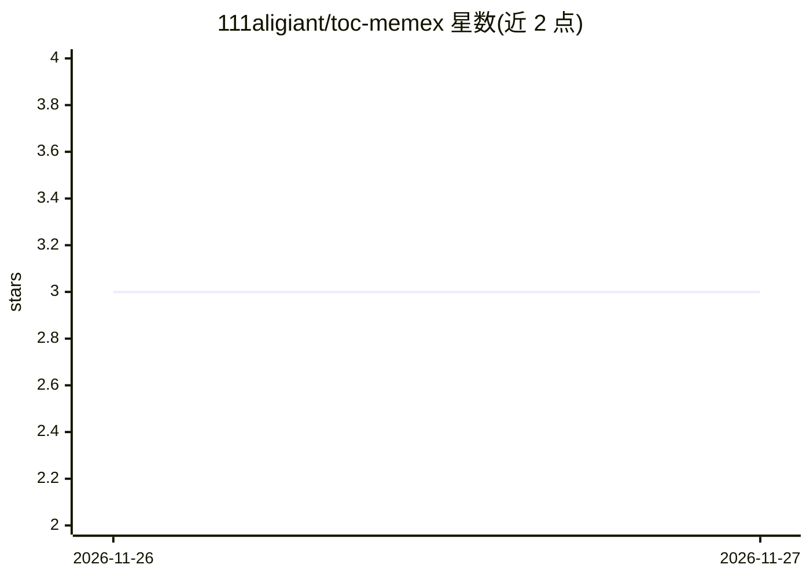

# 111aligiant/toc-memex

⭐ 3 · Python · MIT · 推送 2026-11-25 · [GitHub](https://github.com/111aligiant/toc-memex) · 个人维护 · 中文 README

**把本地文档汇编成可供 Agent 经 MCP 检索的图书馆藏**

将本地 PDF、扫描件、Word 与 Markdown 入库为结构化馆藏：从 PDF 书签、印刷目录页、Word 标题或 OCR 标题重建章节树，印刷页码映射到 PDF 物理页，检索走 SQLite FTS5 BM25 + jieba，返回 doc_id、heading_path 与页码定位。通过 MCP 服务层供 WorkBuddy、DSH、Claude Code 等外部 agent 连入，调用落持久化记录并可回放；派生层修正走提案-快照-回滚流程。限制：主要适配目录结构完整的文档，单机 SQLite 无多租户。

## 筛选速览

| 维度 | 判定 | 备注 |
|---|---|---|
| AI 角色 | `ai-ecosystem` | LLM/agent 周边工具 |
| 许可风险 | `permissive` | MIT |
| 部署形态 | `library` | 以包/库形式分发 |
| 模型依赖 | — | README 未给出锁定关系 |
| 硬件要求 | — | 无带数字的原话,不猜 |
| 安装摩擦 | `low` | 无编译、无系统依赖或容器化 |
| 成熟度 | — | 结构信号不足 |

## 能力要点

- 基于文档结构化目录树的检索，返回章节路径与 PDF 页码定位
- MCP 服务层接入外部 agent，外部会话持久化并可逐步回放
- 派生层治理：修正提案带快照与自动回滚，勘误需第二个 agent 独立复核
- 手记区以 doc_id/node_id/page 锚点跨 agent 留档

## 适用场景

- 标准、法规、合同、专利等需要原文页码引用的文档检索
- 多个 agent 共用同一份本地文档馆藏并互相留档交接
- 对扫描件建立带页码映射的可检索知识库

## 场景标签

`RAG` `文档解析` · 领域:知识与检索

## 证据(README 行号)

> L10: 把本地 PDF、扫描件、Word 与 Markdown 汇编成一个适用你所有Agent的图书馆藏：各切片对齐到小节，印刷页码对齐到 PDF 物理页。
> L14: MCP层适配Workbuddy、DSH、claude code等多种常用Agent，外部会话动态回放；手记区支持跨Agent留档交流。
> L50: Toc Memex 不替 agent 做判断，只提供带地址的工具面。外部 agent 经 MCP 连入后，握手时自报的 `client_info.name` 记为作者，服务端为连接分配 `session_id`，每次调用落一条 `

## 星数曲线

2026-11-26 3 → 2026-11-27 3（+0）

---
*卡片 v1 · prompt 1.4 · 生成 2026-11-26 · 置信度 high · 依据 README sha `d771140784c5` · [字段定义](../../DATASET.md)*
