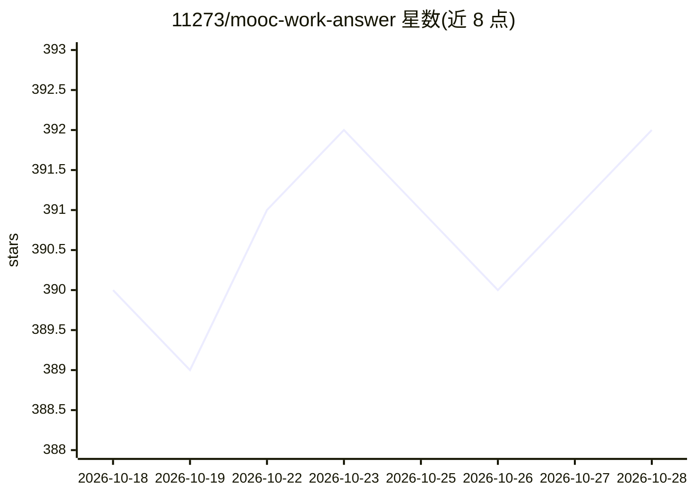

# 11273/mooc-work-answer

⭐ 392 · Python · 推送 2026-09-15 · [GitHub](https://github.com/11273/mooc-work-answer) · 个人维护 · 中文 README

**智慧职教 MOOC 平台学习管理与 AI 答题辅助工具**

面向智慧职教平台（MOOC/AI 优课/资源库）的学习管理工具，通过官方 API 接口实现学习进度管理，并集成 DeepSeek 提供答题辅助（自述参考准确率 60-100%）。功能覆盖学习管理、讨论辅助、作业辅助（开发中）等，已在 38+ 课程做兼容性测试。单线程运行并设置随机时间间隔。提供 Windows 可执行文件下载与 Python 源码两种运行方式，声明仅供学习研究、禁止商业化和大规模批量操作。

## 筛选速览

| 维度 | 判定 | 备注 |
|---|---|---|
| AI 角色 | `ai-native` | 本体是模型或模型工具 |
| 许可风险 | `none` | — |
| 部署形态 | `desktop` | 安装包/桌面程序 |
| 模型依赖 | locked-api |  |
| 硬件要求 | — | 无带数字的原话,不猜 |
| 安装摩擦 | `low` | 无编译、无系统依赖或容器化 |
| 成熟度 | `idea` | |

## 能力要点

- 通过智慧职教官方 API 接口进行数据交互
- 集成 DeepSeek 的 AI 学习/答题辅助（自述参考准确率 60-100%）
- 支持 MOOC、AI 优课、资源库多平台，38+ 课程兼容性测试
- 提供 Releases 可执行文件与 Python 源码两种运行方式

## 适用场景

- 管理智慧职教平台课程的学习进度
- 练习和作业中获取 AI 解题思路与参考答案
- 课程讨论中获取回复建议

## 场景标签

 · 领域:教育/学习自动化工具

## 证据(README 行号)

> L12: ### 🤖 AI 学习辅助`DeepSeek`
> L35: |📝 **学习辅助**|✅|❌|AI 驱动的学习内容理解与分析|已完成|
> L73: - 通过调用智慧职教官方 API 接口进行数据交互

## 星数曲线

2026-10-18 390 → 2026-10-28 392（+2）

---
*卡片 v1 · prompt 1.4 · 生成 2026-10-21 · 置信度 mid · 依据 README sha `3863c1911fef` · [字段定义](../../DATASET.md)*
