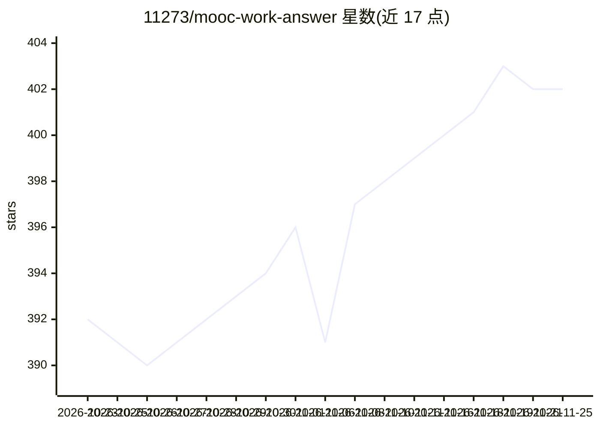

# 11273/mooc-work-answer

⭐ 402 · Python · 推送 2026-11-13 · [GitHub](https://github.com/11273/mooc-work-answer) · 个人维护 · 中文 README

**智慧职教平台的课程学习管理与题目导出工具**

面向智慧职教（MOOC/AI 优课/资源库）与职教云平台的学习管理工具，通过调用平台官方 API 实现学习进度管理与作业/测验/考试题目的题干、选项、答案导出（Markdown/Word 格式）。当前可用功能为学习管理与题目导出；README 说明旧版 AI 答题、讨论辅助与自动交卷代码保留但尚未接入新版平台菜单。提供 Releases 可执行文件与源码运行方式，要求 Python ≥3.12.16，支持 Windows/macOS/Linux。

## 筛选速览

| 维度 | 判定 | 备注 |
|---|---|---|
| AI 角色 | `ai-enhanced` | 去掉 AI 部分产品仍成立 |
| 许可风险 | `none` | — |
| 部署形态 | `desktop` | 安装包/桌面程序 |
| 模型依赖 | — | README 未给出锁定关系 |
| 硬件要求 | — | 无带数字的原话,不猜 |
| 安装摩擦 | `low` | 无编译、无系统依赖或容器化 |
| 成熟度 | — | 结构信号不足 |

## 能力要点

- 通过智慧职教官方 API 交互，单线程运行
- 题目导出支持 Markdown 与 Word（.docx）双格式
- 提供只读兼容性检查（--check）与 SHA-256 自检构建流程
- GitHub Actions 在四个平台原生环境构建并自检

## 适用场景

- 跟踪管理智慧职教平台课程学习进度
- 导出已交卷作业/考试/测验的题目与答案用于复习
- 对职教云平台使用专门的配套版本工具

## 场景标签

 · 领域:教育/学习工具

## 证据(README 行号)

> L8: > 🎓 智慧职教平台学习管理工具，通过官方 API 接口实现学习进度跟踪与辅助功能
> L14: - 旧版 AI 学习辅助代码保留，尚未接入当前平台菜单；当前可用功能为学习管理和题目导出。
> L33: |📤 **题目导出**|✅|❌|导出作业/测验/考试题干与正确答案|已完成|

## 星数曲线

2026-10-23 392 → 2026-11-25 402（+10）

---
*卡片 v1 · prompt 1.4 · 生成 2026-11-25 · 置信度 mid · 依据 README sha `f475b257d8a8` · [字段定义](../../DATASET.md)*
