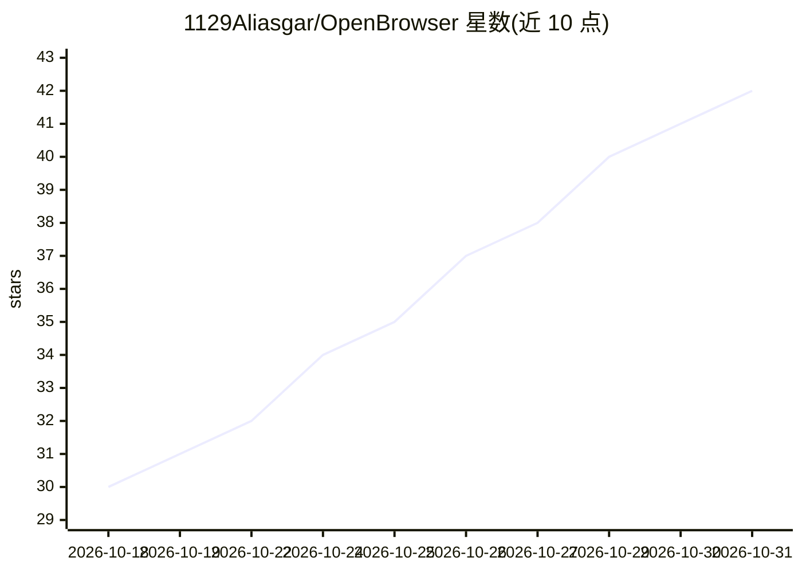

# 1129Aliasgar/OpenBrowser

⭐ 42 · TypeScript · MIT · 推送 2026-08-02 · [GitHub](https://github.com/1129Aliasgar/OpenBrowser) · 个人维护

**把浏览器 AI 订阅桥接为终端本地编码代理的 CLI 工具**

由 CLI 与 Chrome 扩展组成本地桥接层：终端命令生成的提示词经 127.0.0.1:5000 的 Fastify 桥接服务器通过 SSE 推送至扩展，扩展将其注入已打开的浏览器 AI 页面并自动点击发送，回复回流到终端。面向已持有 ChatGPT/Claude/Gemini 等浏览器订阅（含免费档）的开发者，无需 API key。提供 ask 问答模式与 agent 模式（JSON schema 校验、diff 预览、历史记录），支持 7 个 AI 站点。限制：需 Node.js 20+、pnpm 11 与 Chromium 浏览器，CLI 需手动 link 注册。

## 筛选速览

| 维度 | 判定 | 备注 |
|---|---|---|
| AI 角色 | `ai-ecosystem` | LLM/agent 周边工具 |
| 许可风险 | `permissive` | MIT |
| 部署形态 | `library` | 以包/库形式分发 |
| 模型依赖 | locked-api |  |
| 硬件要求 | — | 无带数字的原话,不猜 |
| 安装摩擦 | `low` | 无编译、无系统依赖或容器化 |
| 成熟度 | — | 结构信号不足 |

## 能力要点

- 无需 API key，复用浏览器 AI 订阅（含免费档）
- ask 问答与 agent 文件编辑模式（diff 预览、Zod 校验、历史记录）
- CLI + Chrome 扩展经本地 SSE 桥接服务器（端口 5000）通信
- 超 12000 字符的长提示自动转为 txt 附件发送

## 适用场景

- 用已有的 ChatGPT/Claude 浏览器订阅在终端做问答与代码编辑
- 在 agent 模式下让 AI 提交多文件修改并逐项预览确认
- 避免为编码代理单独支付 API 费用

## 场景标签

`编码 Agent` `浏览器自动化` · 领域:效率与自动化

## 证据(README 行号)

> L18: OpenBrowser is a **free AI tool** and **local AI agent harness** that connects ChatGPT, Gemini, DeepSeek, Claude, P
> L59: In this project, an **AI harness** is the local bridge (CLI + extension) that wires browser chat to your workspace:
> L249: The bridge server is the local API that connects the CLI, browser extension, and file operations.

## 星数曲线

2026-10-18 30 → 2026-10-31 42（+12）

---
*卡片 v1 · prompt 1.4 · 生成 2026-10-25 · 置信度 mid · 依据 README sha `627129f10ee6` · [字段定义](../../DATASET.md)*
