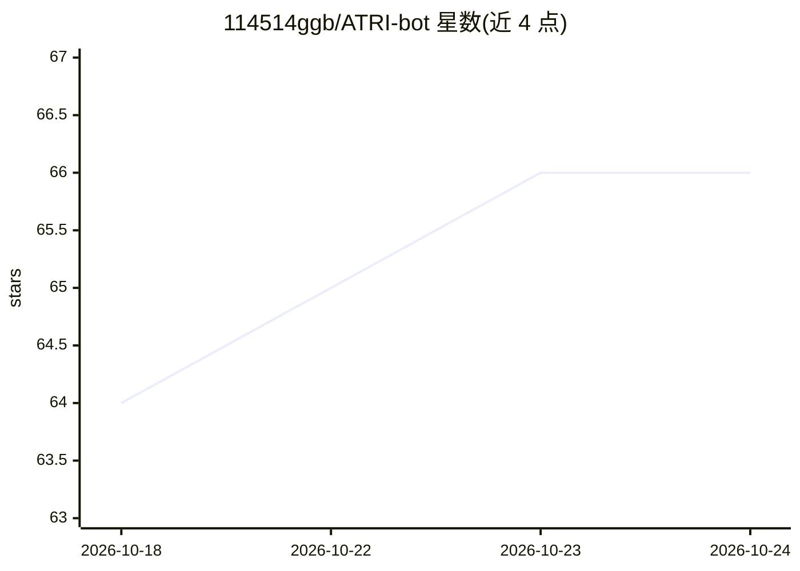

# 114514ggb/ATRI-bot

⭐ 66 · Python · MIT · 推送 2026-10-22 · [GitHub](https://github.com/114514ggb/ATRI-bot) · [官网](https://xn--jlq249bliy.top/) · 个人维护 · 中文 README

**给 QQ 群聊用户的深度定制 LLM 聊天机器人**

基于 NapCat 对接 QQ 的群聊机器人，Python 编写，自主实现 LLM 聊天全链路：Function Calling、MCP 工具调用（内置 18 个工具）、结构化 JSON 决策输出；记忆系统含短期滑动上下文与基于 pgvector 的长期向量记忆（向量+pgroonga 全文双路召回、RRF 融合）。附带 Web 管理面板、插件系统、Docker 代码沙盒（可选）与 GPT-SoVITS 语音合成（可选）。仅支持 PostgreSQL，要求 Python 3.14，提供 Docker Compose 部署；作者自述为萌新私用的学习性质项目。

## 筛选速览

| 维度 | 判定 | 备注 |
|---|---|---|
| AI 角色 | `ai-native` | 本体是模型或模型工具 |
| 许可风险 | `permissive` | MIT |
| 部署形态 | `self-host` | docker 或自建部署 |
| 模型依赖 | local-ok | 支持本地模型 |
| 硬件要求 | — | 无带数字的原话,不猜 |
| 安装摩擦 | `low` | 无编译、无系统依赖或容器化 |
| 成熟度 | `idea` | |

## 能力要点

- 完整 LLM 聊天链路：Function Calling、MCP 工具、结构化 JSON 决策
- 两级记忆：短期滑动上下文 + pgvector 长期向量记忆（混合检索）
- Web 管理面板：配置编辑、记忆浏览、在线聊天
- 可选 Docker 代码沙盒与 GPT-SoVITS 语音合成

## 适用场景

- 在 QQ 群里部署一个能记忆群友偏好、主动参与话题的聊天机器人
- 让 Bot 通过工具调用搜索网页、执行代码、定时发言
- 参考源码学习从零搭建 LLM Bot 的工程实践

## 场景标签

`聊天机器人` · 领域:对话与助手

## 证据(README 行号)

> L45: 一个基于 **NapCat** 对接的 QQ Bot，以群聊场景为核心深度定制
> L51: - **全异步高并发**：回复流程完全异步，支持多供应商 Key 池轮询，多群并发场景下也能稳定运行。

## 星数曲线

2026-10-18 64 → 2026-10-24 66（+2）

---
*卡片 v1 · prompt 1.4 · 生成 2026-10-24 · 置信度 high · 依据 README sha `eeac807c0790` · [字段定义](../../DATASET.md)*
