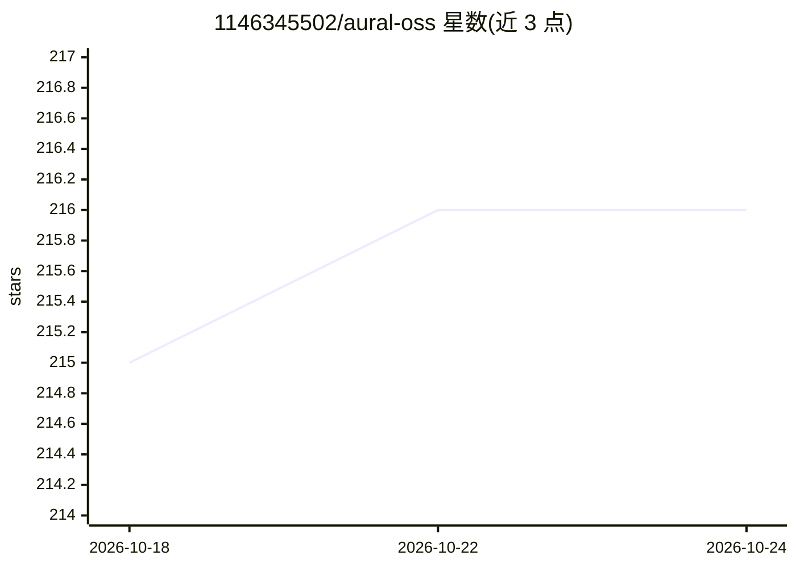

# 1146345502/aural-oss

⭐ 216 · TypeScript · MIT · 推送 2026-10-14 · [GitHub](https://github.com/1146345502/aural-oss) · [官网](https://aural-ai.com) · 个人维护 · 中文 README

**开源 AI 面试平台：语音/文字/视频面试与自动分析报告**

基于 Next.js 16.4、TypeScript 与 Supabase 的自托管 AI 面试平台。用户用自然语言描述目标，AI 生成含题目与评分标准的完整面试，分享链接后由 AI 通过语音、文字或视频自主开展对话（含实时追问），结束后生成按题评分的 AI 报告。内置 Monaco 编程题、Excalidraw 白板、防作弊监控（切屏/粘贴/多屏检测）、练习模式与团队管理。LLM 通过可插拔 Provider 系统接入 OpenAI、Gemini、Kimi、MiniMax 或任意 OpenAI 兼容 API；语音依赖 WebSocket 中继（火山豆包为主、Azure 备用）。自托管需 Node.js、Supabase 项目与至少一个 LLM API key。

## 筛选速览

| 维度 | 判定 | 备注 |
|---|---|---|
| AI 角色 | `ai-native` | 本体是模型或模型工具 |
| 许可风险 | `permissive` | MIT |
| 部署形态 | `self-host` | docker 或自建部署 |
| 模型依赖 | — | README 未给出锁定关系 |
| 硬件要求 | — | 无带数字的原话,不猜 |
| 安装摩擦 | `low` | 无编译、无系统依赖或容器化 |
| 成熟度 | — | 结构信号不足 |

## 能力要点

- 自然语言生成完整面试（题目+评分标准），AI 自主主持语音/文字/视频对话
- 按题评分与多维评估的 AI 自动报告
- Monaco 编程题、Excalidraw 白板与防作弊监控（切屏/粘贴/多屏检测）
- 可插拔 LLM Provider：OpenAI、Gemini、Kimi、MiniMax 或任意 OpenAI 兼容 API

## 适用场景

- 技术招聘中开展含编程与白板题的 AI 面试
- 用户研究与行为面试的大规模语音访谈
- 候选人面试前的语音练习与 AI 反馈
- 通过 REST API 程序化管理面试流程

## 场景标签

`语音 Agent` · 领域:对话与助手

## 证据(README 行号)

> L30:  Design an interview in plain language. Share a link. Aural's AI conducts the conversation —
> L74: Aural is an AI-powered interview platform that conducts structured interviews autonomously. You design an interview

## 星数曲线

2026-10-18 215 → 2026-10-24 216（+1）

---
*卡片 v1 · prompt 1.4 · 生成 2026-10-22 · 置信度 mid · 依据 README sha `0e33d763e246` · [字段定义](../../DATASET.md)*
