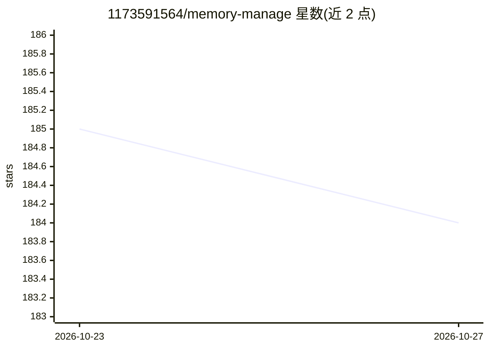

# 1173591564/memory-manage

⭐ 184 · TypeScript · 推送 2026-10-14 · [GitHub](https://github.com/1173591564/memory-manage) · 个人维护 · 中文 README

**LLM/coding agent 的长期记忆层：任务日志存储与检索**

面向 coding agent 的有界长期记忆层 tasklog：以任务分段的事件日志形式记录交互，写入侧零 LLM（纯正则符号抽取），基于 TypeScript + SQLite/FTS5 实现，通过 MCP 工具面向 agent 提供五个查询接口。支持 OpenCode 与 Devin 原始日志导入、embedding 检索与秩融合、切点快照与三臂评估。已导入 Devin 12 个真实会话、23,424 条去重事件；首个真实三臂评估中该任务上记忆未展示收益（n=1）。附设计文档与研究笔记。

## 筛选速览

| 维度 | 判定 | 备注 |
|---|---|---|
| AI 角色 | `ai-ecosystem` | LLM/agent 周边工具 |
| 许可风险 | `none` | — |
| 部署形态 | `library` | 以包/库形式分发 |
| 模型依赖 | — | README 未给出锁定关系 |
| 硬件要求 | — | 无带数字的原话,不猜 |
| 安装摩擦 | `low` | 无编译、无系统依赖或容器化 |
| 成熟度 | `idea` | |

## 能力要点

- 写入侧零 LLM：事件日志 + 纯正则符号抽取，SQLite/FTS5 存储
- 通过 MCP 暴露五个查询工具供 coding agent 接入
- OpenCode 与 Devin 原始日志导入及出处只读快照
- 九个测试套件共 322 项机制/集成检查，三臂评估框架

## 适用场景

- 为 coding agent 提供跨会话的任务历史记忆与检索
- 导入 OpenCode/Devin 日志构建可查询的项目事件库
- 对 agent 记忆机制做对照评估实验

## 场景标签

`Agent 记忆` · 领域:Agent 开发

## 证据(README 行号)

> L4: 按任务分段的事件日志，coding agent 的记忆层。写入侧零 LLM。TypeScript + SQLite/FTS5 + MCP。
> L22: 状态：全部机制测试通过，`tsc --noEmit` 零错误。已导入 Devin 的 12 个真实会话、23,424 条去重事件并核对原文。Devin ACP provider 已打通（凭据本地注入、隔离会话库、`swe-2-ma

## 星数曲线

2026-10-23 185 → 2026-10-27 184（-1）

---
*卡片 v1 · prompt 1.4 · 生成 2026-10-23 · 置信度 high · 依据 README sha `6979a3e01117` · [字段定义](../../DATASET.md)*
