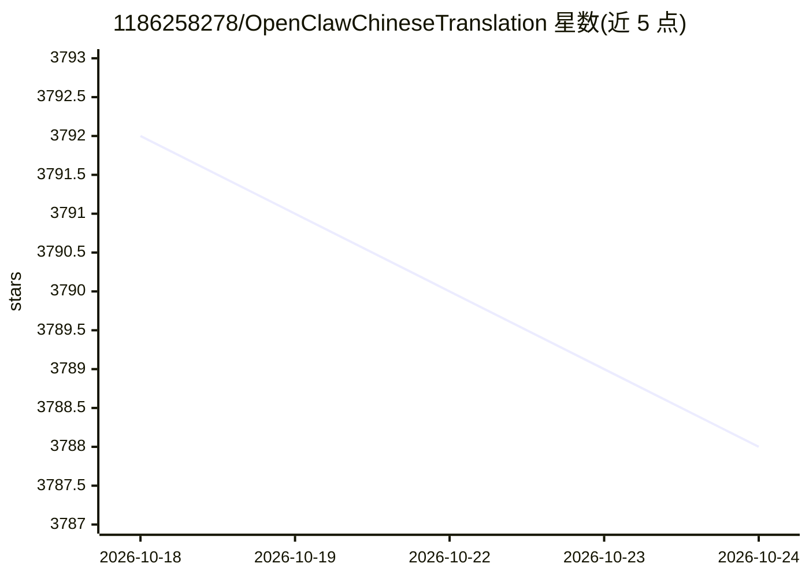

# 1186258278/OpenClawChineseTranslation

⭐ 3,791 · JavaScript · NOASSERTION · 推送 2026-10-19 · [GitHub](https://github.com/1186258278/OpenClawChineseTranslation) · [官网](https://openclaw.qt.cool) · 组织维护 · 中文 README

**OpenClaw 个人 AI 助手平台的全中文汉化发行版**

对开源个人 AI 助手平台 OpenClaw 的 CLI 与 Dashboard 网页控制台做深度汉化的发行版，每小时自动同步上游更新（延迟<1 小时）。上游 OpenClaw 运行在用户电脑上，通过 WhatsApp/Telegram/Discord 等聊天应用与 AI 助手交互，处理邮件、日历、文件等日常事务。提供 npm 安装、Docker 镜像（含国内源）、一键脚本与手机端 ClawApp 生态工具，附全中文搭建教程与排错指南。由武汉晴辰天下网络科技有限公司出品。

## 筛选速览

| 维度 | 判定 | 备注 |
|---|---|---|
| AI 角色 | `ai-native` | 本体是模型或模型工具 |
| 许可风险 | `none` | NOASSERTION |
| 部署形态 | `self-host` | docker 或自建部署 |
| 模型依赖 | — | README 未给出锁定关系 |
| 硬件要求 | — | 无带数字的原话,不猜 |
| 安装摩擦 | `low` | 无编译、无系统依赖或容器化 |
| 成熟度 | — | 结构信号不足 |

## 能力要点

- CLI 与 Dashboard 网页控制台全中文汉化
- 每小时自动同步 OpenClaw 官方更新，延迟<1 小时
- npm 安装、Docker 镜像（国内源）与一键部署脚本多种安装方式
- 配套 ClawPanel 管理面板与 ClawApp 手机端聊天客户端生态工具

## 适用场景

- 在国内网络环境下用中文界面部署 OpenClaw AI 助手
- 通过 WhatsApp/Telegram/Discord 管理和使用个人 AI 助手
- 用手机浏览器（ClawApp）与 AI 助手聊天

## 场景标签

`AI 助手` `聊天机器人` · 领域:对话与助手

## 证据(README 行号)

> L19: OpenClaw 是 GitHub 195,000+ Stars 的**开源个人 AI 助手平台**。它运行在你的电脑上，通过 WhatsApp、Telegram、Discord 等聊天应用与你的 AI 助手交互，帮你处理邮件、日
> L21: **本项目 = OpenClaw + 全中文界面**，CLI 命令行和 Dashboard 网页控制台均已深度汉化。

## 星数曲线

2026-10-18 3,792 → 2026-10-24 3,788（-4）

---
*卡片 v1 · prompt 1.4 · 生成 2026-10-20 · 置信度 high · 依据 README sha `f50111b0eb04` · [字段定义](../../DATASET.md)*
