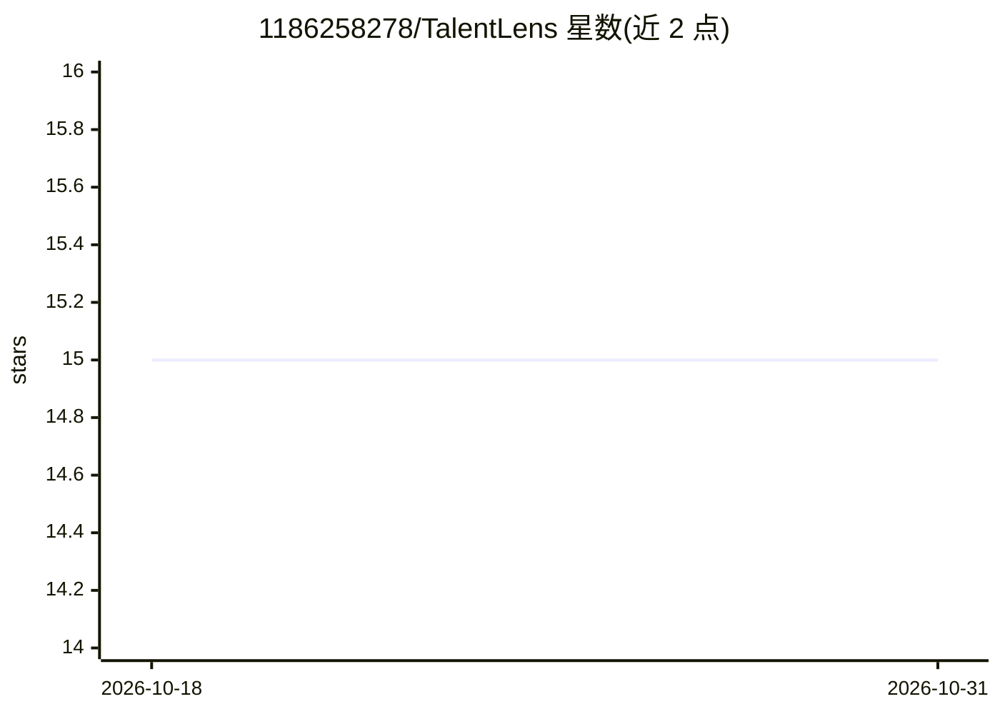

# 1186258278/TalentLens

⭐ 15 · Vue · NOASSERTION · 推送 2026-02-06 · [GitHub](https://github.com/1186258278/TalentLens) · [官网](https://talentLens.qt.cool) · 组织维护 · 中文 README

**给 HR 的 AI 简历筛选桌面应用：拖入即分析打分排序**

基于 Go + Wails + Vue 3 的轻量级桌面应用，面向 HR 简历筛选场景。用户拖入 PDF/Word/图片简历后，应用通过 OpenAI 兼容接口调用 LLM 进行多维度分析（技能/经验/学历匹配度），生成综合评分、排序与推荐结论。预设 DeepSeek、OpenAI、智谱、Moonshot、硅基流动等服务商，也支持自定义 OpenAI 兼容接口。提供 Windows 与 macOS 预编译安装包，下载即用无需安装；亦可通过 Go/Node.js/Wails CLI 从源码构建。GPL-3.0 协议，由武汉晴辰天下网络科技有限公司维护。

## 筛选速览

| 维度 | 判定 | 备注 |
|---|---|---|
| AI 角色 | `ai-native` | 本体是模型或模型工具 |
| 许可风险 | `none` | NOASSERTION |
| 部署形态 | `desktop` | 安装包/桌面程序 |
| 模型依赖 | locked-api |  |
| 硬件要求 | — | 无带数字的原话,不猜 |
| 安装摩擦 | `low` | 无编译、无系统依赖或容器化 |
| 成熟度 | — | 结构信号不足 |

## 能力要点

- 拖拽上传 PDF/Word/图片简历，自动多维度分析与打分
- AI 输出推荐/不推荐结论及详细理由，内置岗位模板一键配置
- 多服务商预设（DeepSeek/OpenAI/智谱/Moonshot/硅基流动），支持任意 OpenAI 兼容接口
- Windows 与 macOS 双平台预编译包，下载双击即用

## 适用场景

- HR 拖入简历批量获得评分与排序结果
- 按内置岗位模板快速配置筛选需求
- 用国产模型（DeepSeek/智谱免费额度）低成本跑简历分析

## 场景标签

 · 领域:人力资源/招聘工具

## 证据(README 行号)

> L24: |**AI 智能分析**|基于 OpenAI 兼容接口，多维度深度分析|
> L26: |**推荐结论**|AI 给出推荐/不推荐结论及详细理由|

## 星数曲线

2026-10-18 15 → 2026-10-31 15（+0）

---
*卡片 v1 · prompt 1.4 · 生成 2026-10-31 · 置信度 high · 依据 README sha `cb1eb16ef035` · [字段定义](../../DATASET.md)*
