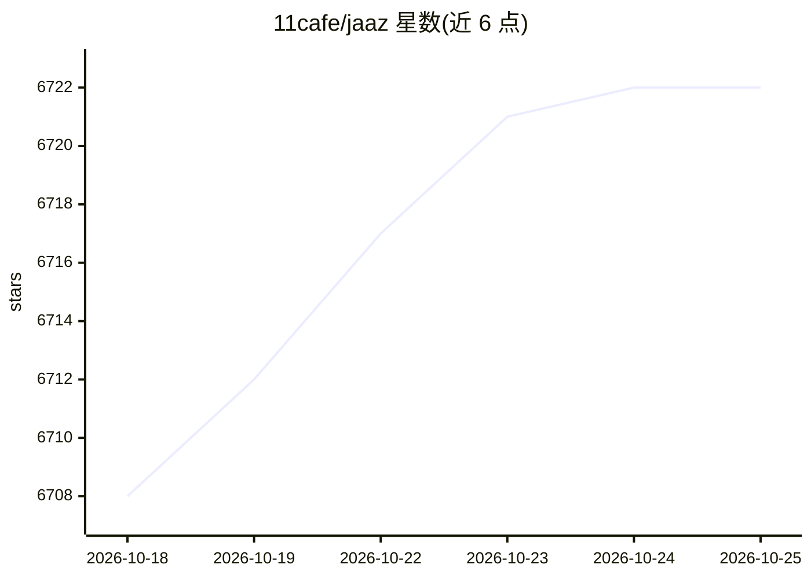

# 11cafe/jaaz

⭐ 6,722 · TypeScript · NOASSERTION · 推送 2026-03-02 · [GitHub](https://github.com/11cafe/jaaz) · [官网](https://jaaz.app) · 个人维护 · 中文 README

**开源多模态创意画布助手：本地生成图像与视频的 Canva 替代品**

面向创作者的桌面端画布应用：在无限画布上通过自然语言对话、简笔涂鸦（Magic Canvas）或分步描述（Magic Video）驱动 AI 生成图像与短视频，支持多角色一致性、视觉故事板与实时协作。模型侧支持云端 API（GPT-4o、Midjourney、VEO3、Kling 等）与本地 ComfyUI/Ollama 混合部署，本地优先、无数据上传。提供 Windows/macOS 安装包下载，Linux/本地构建需 Python≥3.12 并分别安装 React 前端与 Python 服务端；另提供含商业授权的企业云端完整版。

## 筛选速览

| 维度 | 判定 | 备注 |
|---|---|---|
| AI 角色 | `ai-native` | 本体是模型或模型工具 |
| 许可风险 | `none` | NOASSERTION |
| 部署形态 | `library` | 以包/库形式分发 |
| 模型依赖 | local-ok | 支持本地模型 |
| 硬件要求 | — | 无带数字的原话,不猜 |
| 安装摩擦 | `low` | 无编译、无系统依赖或容器化 |
| 成熟度 | — | 结构信号不足 |

## 能力要点

- 一句话生成完整图像或视频，支持 GPT-4o、Midjourney、VEO3、Kling 等模型
- Magic Canvas/Video：无需写提示词，涂鸦或分步描述即可生成
- 支持本地 ComfyUI 与云端 API 混合部署，本地优先不上传数据
- 无限画布、视觉故事板与实时协作

## 适用场景

- 在无限画布上通过对话或涂鸦生成图像和短视频内容
- 本地离线生成创意素材，数据不出设备
- 团队私有化部署多人协作创作

## 场景标签

`图像生成` `视频生成` · 领域:内容生成

## 证据(README 行号)

> L8:  The world's first open-source multimodal canvas creative agent
> L78:  -Works with local (ComfyUI) & cloud models

## 星数曲线

2026-10-18 6,708 → 2026-10-25 6,722（+14）

---
*卡片 v1 · prompt 1.4 · 生成 2026-10-20 · 置信度 high · 依据 README sha `b7d399771a1d` · [字段定义](../../DATASET.md)*
