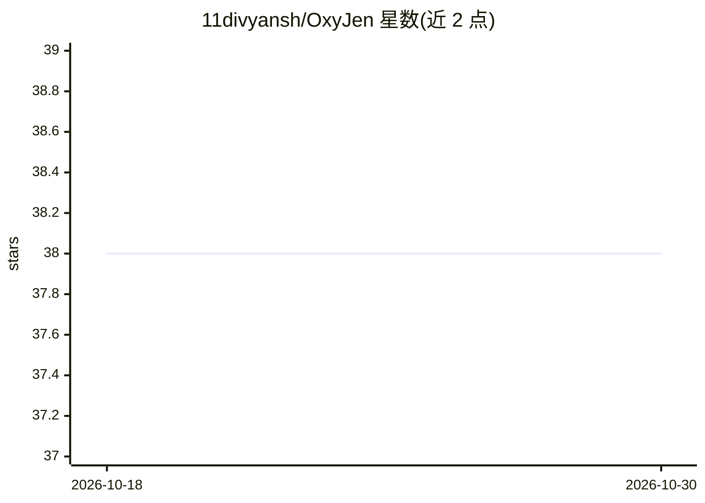

# 11divyansh/OxyJen

⭐ 38 · Java · Apache-2.0 · 推送 2026-09-12 · [GitHub](https://github.com/11divyansh/OxyJen) · 个人维护

**面向 Java/JVM 开发者的 LLM 工作流图式编排框架**

开源 Java 框架，以图（Graph）结构编排 LLM 与数据处理节点，构建多步 AI 流水线。核心概念为 Graph（流水线蓝图）、NodePlugin（处理单元）、Executor（执行引擎）、NodeContext（跨节点共享状态与日志），提供节点生命周期钩子与确定性执行。README 中与 LangChain4j 做定位区分：后者侧重集成广度，OxyJen 侧重运行时可靠性与生产就绪。当前版本 v0.5，Phase 6（成本管理、审计、多租户等）开发中，作者为在读 BTech CS 学生，自述始于学习项目。通过 Maven/Gradle（JitPack）或源码编译安装。

## 筛选速览

| 维度 | 判定 | 备注 |
|---|---|---|
| AI 角色 | `ai-ecosystem` | LLM/agent 周边工具 |
| 许可风险 | `permissive` | Apache-2.0 |
| 部署形态 | `None` |  |
| 模型依赖 | — | README 未给出锁定关系 |
| 硬件要求 | — | 无带数字的原话,不猜 |
| 安装摩擦 | `low` | 无编译、无系统依赖或容器化 |
| 成熟度 | `idea` | |

## 能力要点

- Graph/NodePlugin/Executor/NodeContext 四核心抽象构建 AI 流水线
- 节点生命周期钩子（onStart/onFinish）与跨节点共享状态
- Apache 2.0 许可，Maven/Gradle（JitPack）分发
- 规划中的企业特性：审计日志、RBAC、多租户、熔断器、成本追踪

## 适用场景

- 在 Java 项目中编排多步 LLM 流水线
- 构建带共享状态与可观测日志的 AI 工作流
- 需要图式 DAG 结构组织 AI 处理步骤的企业开发

## 场景标签

`Agent 框架` `工作流自动化` · 领域:Agent 开发

## 证据(README 行号)

> L9: Oxyjen is a **graph-based orchestration framework** for building AI applications in Java. It provides a clean, exten
> L144: - Bring AI orchestration (LangChain/LangGraph style) to Java.
> L216: Built with ❤️ by Divyansh Bhatt - a BTech CS student who believes Java deserves world-class AI tooling.

## 星数曲线

2026-10-18 38 → 2026-10-30 38（+0）

---
*卡片 v1 · prompt 1.4 · 生成 2026-10-25 · 置信度 high · 依据 README sha `64877a5e9e72` · [字段定义](../../DATASET.md)*
