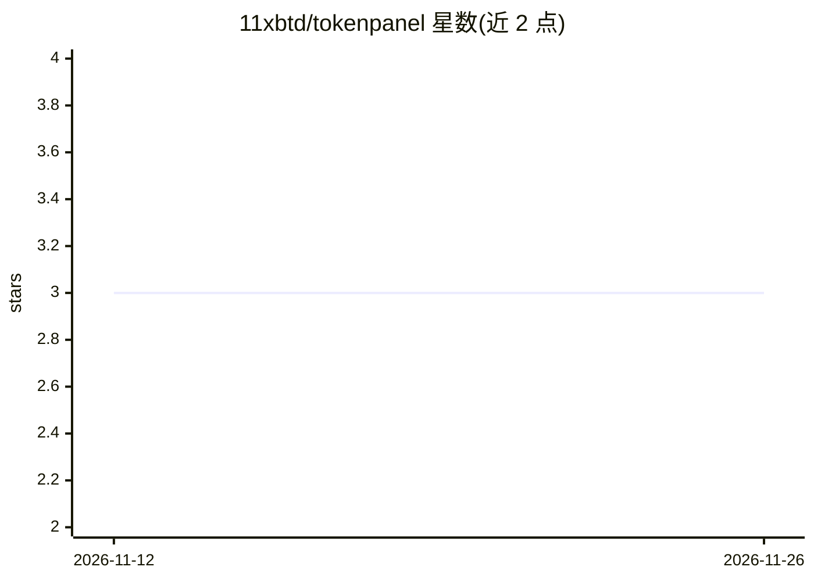

# 11xbtd/tokenpanel

⭐ 3 · TypeScript · MIT · 推送 2026-11-12 · [GitHub](https://github.com/11xbtd/tokenpanel) · 个人维护 · 中文 README

**给 AI 开发者集中查看 token 用量与各厂商余额的本地看板**

以 uTools 插件与浏览器本地服务两种形态运行，聚合多厂商的 API 余额、订阅套餐额度窗口、按天/账户/模型的 token 消耗统计与 CSV 导出；通过厂商官方余额/用量接口、中转站日志、11 类本机客户端日志与手动/CSV 录入取数，数据经 AES-256-GCM 加密仅存本机，无遥测。另聚合 AI 厂商动态与接入 Artificial Analysis 的模型排行。明确不做代理/网关，也不做多租户，为单人本地工具。

## 筛选速览

| 维度 | 判定 | 备注 |
|---|---|---|
| AI 角色 | `ai-ecosystem` | LLM/agent 周边工具 |
| 许可风险 | `permissive` | MIT |
| 部署形态 | `library` | 以包/库形式分发 |
| 模型依赖 | locked-api |  |
| 硬件要求 | — | 无带数字的原话,不猜 |
| 安装摩擦 | `low` | 无编译、无系统依赖或容器化 |
| 成熟度 | — | 结构信号不足 |

## 能力要点

- 按量 API 与订阅套餐两类额度卡片及窗口重置时间轴
- 适配 11 类本机客户端日志（Kimi Code/Claude Code/Codex CLI/Gemini CLI 等）补齐套餐 token 明细
- 接 Artificial Analysis 免费接口展示模型智能指数、速度与价格排行
- 账户密钥 AES-256-GCM 加密仅存本机，无遥测

## 适用场景

- 集中查看多个 LLM 厂商账户的余额与套餐剩余窗口
- 按模型/按天统计本机 token 消耗并导出 CSV
- 追踪 AI 厂商动态与比较模型价格速度

## 场景标签

`LLM 可观测性` · 领域:评测与运维

## 证据(README 行号)

> L3: AI Token 用量、余额 / 套餐额度、AI 动态与模型排行看板。形态是 **uTools 插件 + 浏览器本地服务**，预制主流厂商配置，数据只存本机。
> L32: - **不做代理/网关**：没有“把 base_url 指过来就自动记每次调用”的透传代理。uTools 插件没有后台常驻进程，做不了透明代理。

## 星数曲线

2026-11-12 3 → 2026-11-26 3（+0）

---
*卡片 v1 · prompt 1.4 · 生成 2026-11-22 · 置信度 high · 依据 README sha `f84f27a392f2` · [字段定义](../../DATASET.md)*
