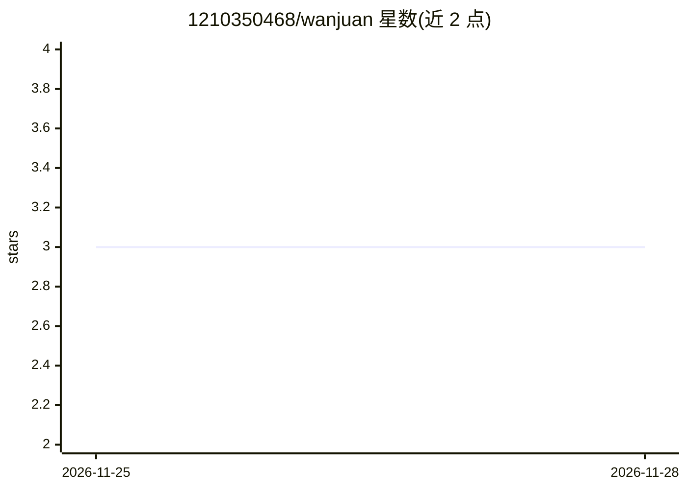

# 1210350468/wanjuan

⭐ 3 · TypeScript · GPL-3.0 · 推送 2026-11-19 · [GitHub](https://github.com/1210350468/wanjuan) · [官网](https://github.com/1210350468/wanjuan/releases/latest) · 个人维护 · 中文 README

**网文作者的本地优先 AI 长篇小说写作台**

Electron 桌面应用，覆盖选题、设定、架构、章节蓝图、正文、审稿、修稿、定稿的完整写作流程，作品存本地 SQLite 与文件夹。AI 部分负责起草：接入 OpenAI 兼容服务、Gemini 原生协议或本机 CLI 执行器（codex/gemini/claude），也可用 Ollama 跑本地模型；不自带模型、不代管额度。特色功能包括番茄书库榜单选题、多书融合配单评分、小说拆解仿写、写作 Skill 导入与 WebDAV 备份。提供 Windows 安装包与 macOS 安装包，均未正式签名；可从源码构建，需 Node.js 与 pnpm。

## 筛选速览

| 维度 | 判定 | 备注 |
|---|---|---|
| AI 角色 | `ai-native` | 本体是模型或模型工具 |
| 许可风险 | `viral` | GPL-3.0 |
| 部署形态 | `desktop` | 安装包/桌面程序 |
| 模型依赖 | local-ok | 支持本地模型 |
| 硬件要求 | — | 无带数字的原话,不猜 |
| 安装摩擦 | `low` | 无编译、无系统依赖或容器化 |
| 成熟度 | — | 结构信号不足 |

## 能力要点

- 番茄书库选题：榜单浏览、配单诊断与五项 0-100 评分（热度/追读/结构/节奏/题材集中）
- 多书融合：勾选 2-5 本生成新书设定与大纲，不复刻原作人物与情节
- 写作 Skill 超市：从 GitHub 扫描安装提示词型 SKILL.md，绑定到规划/写稿/审稿/修稿阶段
- 三种调用方式：OpenAI 兼容、Gemini 原生、本机 CLI 执行器（codex/gemini/claude/agy）

## 适用场景

- 从选题到定稿在本地完成一部长篇网文的写作
- 按番茄榜单配单融合多本参考书生成新作品设定
- 导入已有原稿或 txt/epub 小说做拆解、仿写与续写
- 用 Ollama 本地模型零成本起草并保护作品隐私

## 场景标签

`AI 写作` · 领域:内容生成

## 证据(README 行号)

> L14:  免费开源的 AI 小说写作软件。选题、设定、架构、章节蓝图、正文、审稿、修稿、定稿，在一部作品里走完。
> L15:  作品存在你自己的电脑上；软件不带模型，接你自己的 API Key，或用 Ollama 跑本地模型。
> L80: ### 番茄书库：搜书选题与多书融合

## 星数曲线

2026-11-25 3 → 2026-11-28 3（+0）

---
*卡片 v1 · prompt 1.4 · 生成 2026-11-24 · 置信度 mid · 依据 README sha `12e4d2b0e7a9` · [字段定义](../../DATASET.md)*
