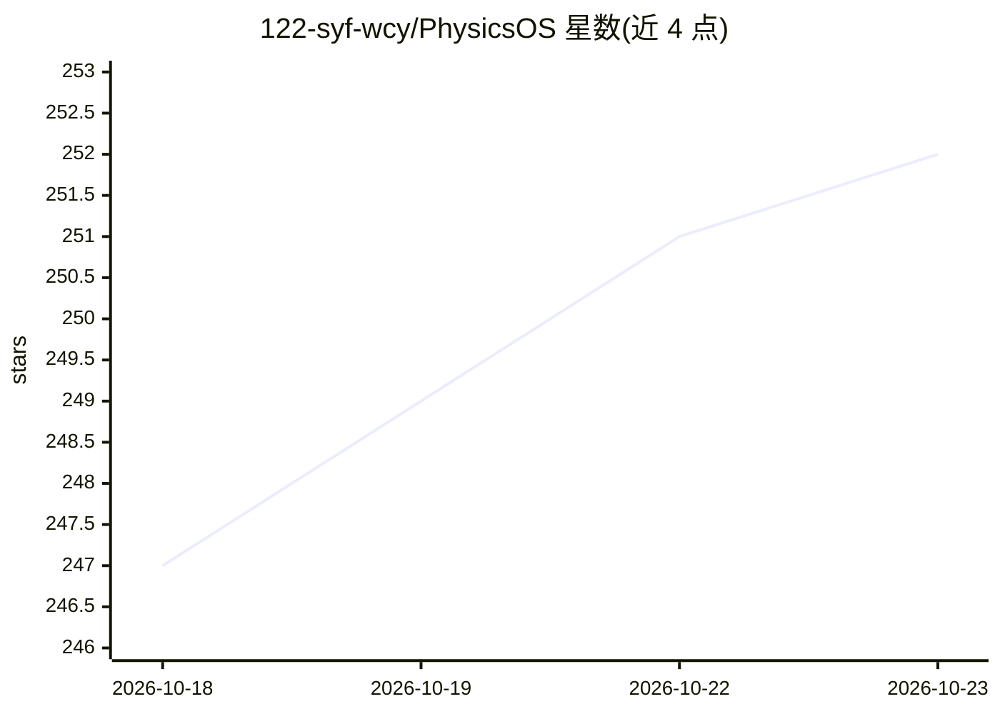

# 122-syf-wcy/PhysicsOS

⭐ 252 · TypeScript · Apache-2.0 · 推送 2026-10-11 · [GitHub](https://github.com/122-syf-wcy/PhysicsOS) · [官网](https://physics.dongsiwei.com) · 个人维护 · 中文 README

**面向初高中物理学习的公益可视化 AI 智能体：AI 解题+物理引擎仿真**

面向初高中物理教学的个人物理实验与学习平台（非学校 LMS）。AI 理解题面后调用物理引擎，将力学、电磁、光学、机械波等十二类物理过程转化为可交互、可校验的可视化场景；会话 Agent 通过 physics_solve_question 等七个工具解题、开实验、改条件，数值全部来自领域引擎并逐项验证。运行在 DeepSeek Harness Web Client 之上，含 80 道内置题、题转实验室与跨设备学习记录同步。公测阶段，单副本部署，需 Node.js>=24 与 Git submodule/overlay 流程启动。

## 筛选速览

| 维度 | 判定 | 备注 |
|---|---|---|
| AI 角色 | `ai-native` | 本体是模型或模型工具 |
| 许可风险 | `permissive` | Apache-2.0 |
| 部署形态 | `library` | 以包/库形式分发 |
| 模型依赖 | locked-api |  |
| 硬件要求 | — | 无带数字的原话,不猜 |
| 安装摩擦 | `low` | 无编译、无系统依赖或容器化 |
| 成熟度 | `idea` | |

## 能力要点

- 十二类物理实验领域引擎（力学/电路/电磁感应/光学/机械波等），数值由引擎给出并带验证测试
- Agent 通过七个工具调用物理引擎解题与仿真，数值不来自模型本身
- 80 道内置题的 Question Runtime/Engine/Verifier/Observation 链，题与实验室共享同一 PhysicsScene
- 用户侧公共模型背后为管理员可运维的模型通道与号池

## 适用场景

- 学生输入物理题，获得 AI 讲解与引擎给定的可视化可复现场景
- 在实验中心调节参数观察电路、磁场、机械波等物理过程
- 教师以个人账号演示实验与解题链路

## 场景标签

`AI 助手` · 领域:对话与助手

## 证据(README 行号)

> L22: PhysicsOS 是一个面向初高中物理学习的公益可视化智能体，通过 AI 理解题目并结合物理引擎，将抽象物理过程转化为可交互、可观察、可计算、可验证的真实物理场景。
> L83: - Harness 会话里的模型可以真正调用物理引擎：Agent 预设「物理学习模式」（`physics-student`）挂载 `@deepseek-ai/dsh-tool-physicsos`，模型通过 `physics_so

## 星数曲线

2026-10-18 247 → 2026-10-23 252（+5）

---
*卡片 v1 · prompt 1.4 · 生成 2026-10-22 · 置信度 mid · 依据 README sha `127a66f7f9ee` · [字段定义](../../DATASET.md)*
