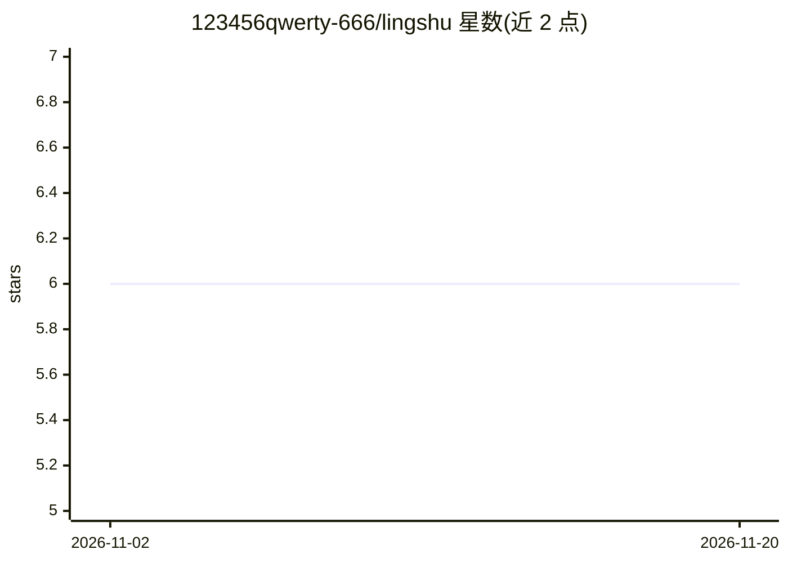

# 123456qwerty-666/lingshu

⭐ 6 · JavaScript · MIT · 推送 2026-11-19 · [GitHub](https://github.com/123456qwerty-666/lingshu) · 个人维护 · 中文 README

**本机运行的微信 AI 助手平台，零依赖纯 Node.js**

本地优先的 AI 中枢：将模型、记忆、工具接入本机服务，再通过第三方 HTTP 读写组件对接微信（也支持 QQ/NapCat）。核心机制包括艾宾浩斯遗忘曲线三层记忆（会话/群成员/人物画像）、按 512K 上下文设计的滚动压缩、OpenAI 兼容多提供商自动降级、目录式插件系统与中文单页控制台。纯 Node.js 零第三方依赖，git clone 后直接运行；微信读写组件属第三方项目需另装，注入方式存在账号风险需自行评估。

## 筛选速览

| 维度 | 判定 | 备注 |
|---|---|---|
| AI 角色 | `ai-native` | 本体是模型或模型工具 |
| 许可风险 | `permissive` | MIT |
| 部署形态 | `desktop` | 安装包/桌面程序 |
| 模型依赖 | local-ok | 支持本地模型 |
| 硬件要求 | — | 无带数字的原话,不猜 |
| 安装摩擦 | `medium` | 含编译或系统依赖之一 |
| 成熟度 | — | 结构信号不足 |

## 能力要点

- 艾宾浩斯遗忘曲线记忆：按重要度分层淡忘，检索命中即复习，无向量数据库
- OpenAI 兼容多提供商接入，429/5xx 等错误自动降级到备用
- 插件系统：一个目录两个文件，控制台在线改码热重载
- 中文控制台含实时日志、发送自检与记忆后台管理

## 适用场景

- 在自己电脑上跑一个有记忆、能联网搜索和画图的微信聊天助手
- 用免费额度/中转接口时自动切换备用提供商避免限流中断
- 给群聊机器人配置人设并记住每位群成员的信息
- 零依赖环境下快速部署可自行修改源码的 AI 助手

## 场景标签

`AI 助手` `聊天机器人` · 领域:对话与助手

## 证据(README 行号)

> L3: > 一个跑在你自己电脑上的微信 AI 助手平台。
> L17: 灵枢是一个**本地优先**的 AI 中枢：它把「模型」「记忆」「工具」三样东西接到一个你能完全掌控的地方，
> L71: - 任意 OpenAI 兼容端点：DeepSeek、OpenAI、Gemini 中转、各类代理、本地 vLLM / Ollama（OpenAI 兼容模式）

## 星数曲线

2026-11-02 6 → 2026-11-20 6（+0）

---
*卡片 v1 · prompt 1.4 · 生成 2026-11-20 · 置信度 mid · 依据 README sha `5379fc32475b` · [字段定义](../../DATASET.md)*
