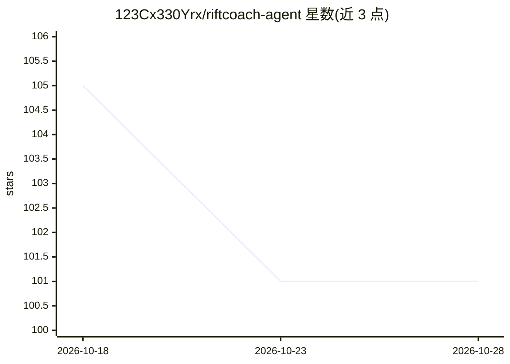

# 123Cx330Yrx/riftcoach-agent

⭐ 101 · Python · MIT · 推送 2026-10-28 · [GitHub](https://github.com/123Cx330Yrx/riftcoach-agent) · 个人维护 · 中文 README

**英雄联盟赛后复盘教练 Agent：数据计算+RAG+LLM 生成带门控的中文报告**

基于 Riot 公开赛后数据的复盘与训练助手：Riot API 与 Data Dragon 提供对局事实与静态映射，MatchAnalyzer 计算补刀/经济/伤害/视野等确定性指标，本地 RAG v1（BM25+hashing embedding 混合召回）提供解释证据，智谱 GLM 生成教练式中文报告；独立评测检查数字忠实度与过度推断，Harness 状态机决定是否发布，未过门控则降级发布确定性报告。包含 FastAPI 异步任务基座、PostgreSQL 持久化任务、受限 Agent Loop、Skill Router 与两个用户 Skill。边界：正式 Auth/RSO、SSE/前端、多源融合与真实模型领域能力准入尚未实现。需 Python 3.11、Riot API Key 与智谱 GLM 配置。

## 筛选速览

| 维度 | 判定 | 备注 |
|---|---|---|
| AI 角色 | `ai-native` | 本体是模型或模型工具 |
| 许可风险 | `permissive` | MIT |
| 部署形态 | `self-host` | docker 或自建部署 |
| 模型依赖 | — | README 未给出锁定关系 |
| 硬件要求 | — | 无带数字的原话,不猜 |
| 安装摩擦 | `low` | 无编译、无系统依赖或容器化 |
| 成熟度 | `idea` | |

## 能力要点

- 确定性指标计算与版本化 Player Summary Schema v1.0
- 本地 RAG v1：BM25+RRF 混合召回、证据门控、拒答与独立保留集门禁
- Harness 质量门控状态机：生成→评测→受限修订→再评测→发布决策
- 受限 Agent Loop 与 Skill Contract/Router（声明式确定性路由）

## 适用场景

- 我打完排位后想要一份基于真实对局数据的复盘报告
- 我想让 AI 教练依据我的近期表现给出训练建议
- 我想本地跑一套带质量门控的 RAG+LLM 报告生成流水线

## 场景标签

`RAG` · 领域:知识与检索

## 证据(README 行号)

> L3: RiftCoach 是一个基于 Riot 公开赛后数据的英雄联盟复盘与训练助手。项目坚持“程序计算事实、知识库提供解释依据、模型负责组织表达、独立评测决定是否发布”的设计原则。
> L27: - 智谱 GLM：依据事实与检索证据生成教练式中文报告；

## 星数曲线

2026-10-18 105 → 2026-10-28 101（-4）

---
*卡片 v1 · prompt 1.4 · 生成 2026-10-23 · 置信度 high · 依据 README sha `039c846f7b12` · [字段定义](../../DATASET.md)*
