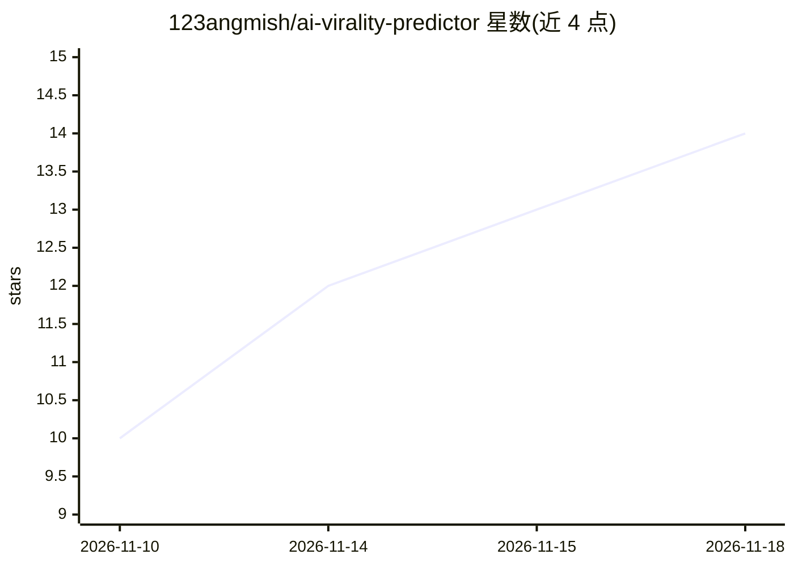

# 123angmish/ai-virality-predictor

⭐ 14 · JavaScript · MIT · 推送 2026-09-12 · [GitHub](https://github.com/123angmish/ai-virality-predictor) · [官网](https://ai-virality-predictor.vercel.app/) · 个人维护

**给短视频创作者做发布前病毒式传播预测的工具**

面向短视频创作者的发布前诊断平台：上传 .mp4/.mov 文件或粘贴视频链接后，用 OpenCV 提取开场运动与场景切换、Librosa 提取音频能量，yt-dlp 解析链接元数据，再由 HistGradientBoosting 模型输出 0-100 病毒性评分、AI 视频摘要、逐秒信号时间线与针对 TikTok/YouTube Shorts/Instagram Reels 等平台的剪辑清单与发布时间建议。前端 Next.js，后端 FastAPI，提供团队工作区与用户隔离历史，部署于 Vercel 与 Render。

## 筛选速览

| 维度 | 判定 | 备注 |
|---|---|---|
| AI 角色 | `ai-native` | 本体是模型或模型工具 |
| 许可风险 | `permissive` | MIT |
| 部署形态 | `library` | 以包/库形式分发 |
| 模型依赖 | — | README 未给出锁定关系 |
| 硬件要求 | — | 无带数字的原话,不猜 |
| 安装摩擦 | `low` | 无编译、无系统依赖或容器化 |
| 成熟度 | — | 结构信号不足 |

## 能力要点

- 0-100 病毒性评分与预估观看触达
- 提取 7 个信号特征：开场光流、场景切换率、音频 RMS、语速等
- 模型 HistGradientBoostingRegressor，R²=0.8714，RMSE=7.74
- 多平台剪辑蓝图矩阵与逐秒交互信号时间线

## 适用场景

- 发布前预测短视频的病毒式传播潜力
- 定位前 3 秒留人问题并获取替代开场脚本
- 按平台生成剪辑与发布时间计划

## 场景标签

`图像视频处理` `数据分析` · 领域:效率与自动化

## 证据(README 行号)

> L3: > **An AI-powered "Doctor for Short-Form Videos"** that predicts virality scores, identifies retention flaws, and ge
> L18: **AI Virality Predictor** solves this by acting as a **pre-publish diagnostic tool**:
> L57: |**Machine Learning**|**Scikit-Learn** (`HistGradientBoosting`)|Predicts continuous 0-100 virality score|

## 星数曲线

2026-11-10 10 → 2026-11-18 14（+4）

---
*卡片 v1 · prompt 1.4 · 生成 2026-11-18 · 置信度 high · 依据 README sha `08fc35241df0` · [字段定义](../../DATASET.md)*
