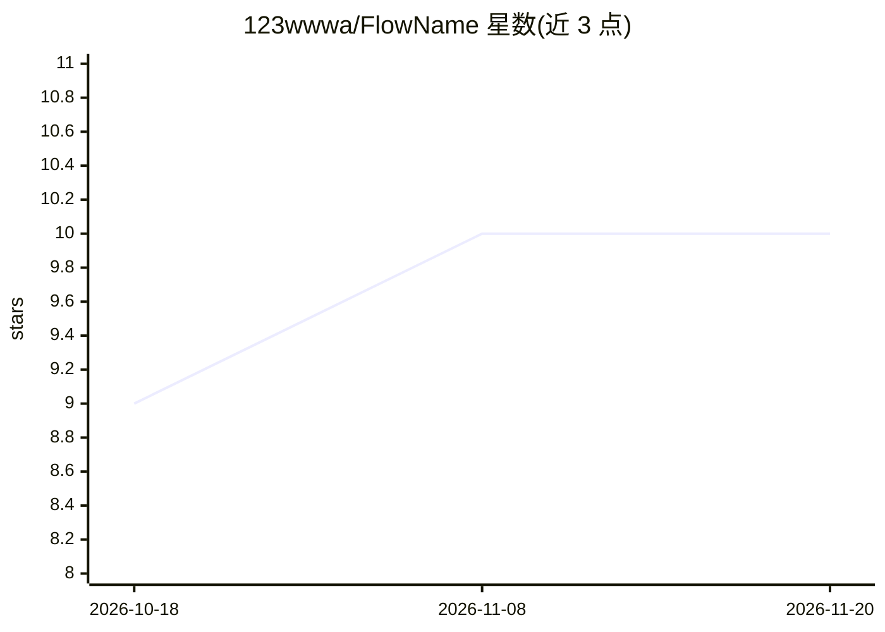

# 123wwwa/FlowName

⭐ 10 · JavaScript · MIT · 推送 2026-10-21 · [GitHub](https://github.com/123wwwa/FlowName) · [官网](https://123wwwa.github.io/FlowName/) · 个人维护

**用 LLM 恢复混淆 JavaScript 标识符原名的工具**

面向被混淆 JavaScript 的语义标识符恢复工具：先以 AST 静态分析把逻辑相关的变量分组，再按预算组织 LLM 请求批量命名，以避免朴素文本窗口方法的上下文丢失问题。提供浏览器 playground（无需安装）、CLI 与 npm 库三种使用方式，默认使用 Gemini，也可指向 OpenAI 兼容端点；支持 --dry-run 预估成本、样例请求与实时 HTML 报告。仅处理词法绑定命名，不解包 bundle 或还原结构性混淆。

## 筛选速览

| 维度 | 判定 | 备注 |
|---|---|---|
| AI 角色 | `ai-native` | 本体是模型或模型工具 |
| 许可风险 | `permissive` | MIT |
| 部署形态 | `library` | 以包/库形式分发 |
| 模型依赖 | — | README 未给出锁定关系 |
| 硬件要求 | — | 无带数字的原话,不猜 |
| 安装摩擦 | `low` | 无编译、无系统依赖或容器化 |
| 成熟度 | — | 结构信号不足 |

## 能力要点

- AST 分组将相关变量合并入预算化 LLM 请求
- 支持浏览器 playground、CLI（npx）与 npm 库三种使用方式
- --dry-run 预估 API 调用与提示字节数，无需 key
- 可通过 --base-url 接入任意 OpenAI 兼容端点

## 适用场景

- 恢复混淆 JavaScript 中的变量与函数原名
- 逆向分析时配合 webcrack/Wakaru 的输出做命名还原
- 批量处理大型混淆文件前先预估 token 成本

## 场景标签

 · 领域:开发工具/逆向工程

## 证据(README 行号)

> L13: **FlowName** is a next-generation Semantic Identifier Recoverer for obfuscated JavaScript. By using AST-based stati
> L9: **Try FlowName in your browser →** — enter your JavaScript, API key and model; no installation required.

## 星数曲线

2026-10-18 9 → 2026-11-20 10（+1）

---
*卡片 v1 · prompt 1.4 · 生成 2026-11-20 · 置信度 high · 依据 README sha `86d8dc84e895` · [字段定义](../../DATASET.md)*
