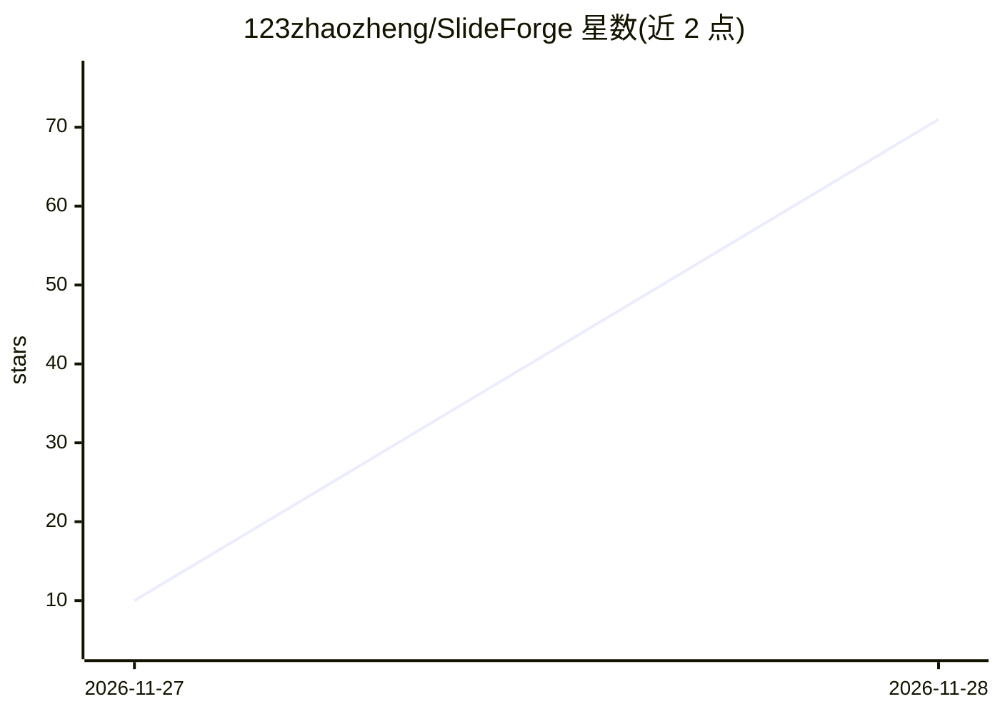

# 123zhaozheng/SlideForge

⭐ 71 · Python · MIT · 推送 2026-11-27 · [GitHub](https://github.com/123zhaozheng/SlideForge) · 个人维护 · 中文 README

**把文档/想法/AI扁平幻灯片转为原生可编辑 PPTX 的 Agent 技能**

以 SKILL.md 形式分发的 Agent 技能：读取用户简报、文档或扁平幻灯片图片，通过分批 AI 组件精灵图（每批 ≤8 图标）与 OOXML 向量代码四层重建（用户背景层/原生矢量层/透明 AI 组件层/可编辑排版层），生成 100% 原生可编辑的 .pptx。内置 alpha 抠图与棋盘预览质检，并用真实 PowerPoint/WPS/LibreOffice 渲染回 PNG 做排版校验。支持 Claude Code、Cursor、Codex、Antigravity 等运行环境。

## 筛选速览

| 维度 | 判定 | 备注 |
|---|---|---|
| AI 角色 | `ai-native` | 本体是模型或模型工具 |
| 许可风险 | `permissive` | MIT |
| 部署形态 | `None` |  |
| 模型依赖 | — | README 未给出锁定关系 |
| 硬件要求 | — | 无带数字的原话,不猜 |
| 安装摩擦 | `low` | 无编译、无系统依赖或容器化 |
| 成熟度 | — | 结构信号不足 |

## 能力要点

- 四层 OOXML 重建，Ctrl+A 可选中的全部原生对象
- OpenAI 兼容图像 API 分批生成组件图并锁定风格
- 真实 PowerPoint/WPS/LibreOffice 渲染回 PNG 做质检
- 显式东亚/拉丁/复杂脚本字体标签避免 CJK 回退宋体

## 适用场景

- 把 Markdown 简报或文档一键变成可编辑的汇报 PPT
- 把已有的扁平 AI 幻灯片图片重建为原生可编辑 PPTX
- 在公司模板背景上生成带真实图片槽位的幻灯片

## 场景标签

 · 领域:办公/文档生成

## 证据(README 行号)

> L10:  An Agent-first skill that builds layered PowerPoint decks from AI component sprite sheets and OOXML vector code, v
> L141: SlideForge ships as a standard Agent Skill (`SKILL.md`) compatible with Claude Code, Cursor, Codex, and Antigravit

## 星数曲线

2026-11-27 10 → 2026-11-28 71（+61）

---
*卡片 v1 · prompt 1.4 · 生成 2026-11-27 · 置信度 high · 依据 README sha `01eea755bc66` · [字段定义](../../DATASET.md)*
