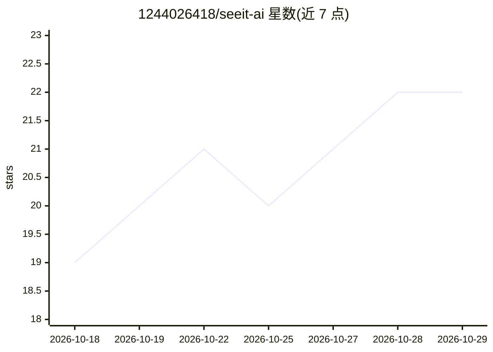

# 1244026418/seeit-ai

⭐ 22 · Python · 推送 2026-07-30 · [GitHub](https://github.com/1244026418/seeit-ai) · 个人维护 · 中文 README

**长视频理解与证据分析的 Video Agent 平台**

面向长视频内容理解的 Video Agent 平台：将视频转写（faster-whisper 本地 ASR/远程 ASR）、PaddleOCR 关键帧证据与用户目标组织成可追溯的结构化分析报告。核心机制包括 LangGraph 结构化 Agent 图（Planner 生成证据槽位、Verifier 分级证据支持、Critic 收尾）、Coverage-Aware 检索（lexical+BGE dense+RRF）、Qdrant 向量索引、RocketMQ 异步任务与 MCP Server（14 工具、4 资源模板）。限制：公网演示默认 Mock Provider；检索评测开发集提升未在最终留出集泛化。技术栈 FastAPI+Vue+MySQL+Redis，Docker Compose 部署。

## 筛选速览

| 维度 | 判定 | 备注 |
|---|---|---|
| AI 角色 | `ai-native` | 本体是模型或模型工具 |
| 许可风险 | `none` | — |
| 部署形态 | `self-host` | docker 或自建部署 |
| 模型依赖 | locked-api |  |
| 硬件要求 | — | 无带数字的原话,不猜 |
| 安装摩擦 | `low` | 无编译、无系统依赖或容器化 |
| 成熟度 | — | 结构信号不足 |

## 能力要点

- LangGraph Agent 图：槽位规划、Evidence Ledger、Verifier 证据分级与 Critic 收尾
- faster-whisper 本地 ASR + PaddleOCR 关键帧证据时间轴
- MCP Server 提供 14 个工具与 4 个资源模板，按用户 Token 隔离
- 检索评测集输出 Recall@K、MRR、多证据完整命中与拒答指标

## 适用场景

- 上传或导入长视频后生成带时间轴证据引用的分析报告
- 课程笔记、会议复盘、操作指南、证据审计四类 Skill 场景
- 通过 MCP 将视频分析能力接入 agent 工作流
- 对视频问答回答做证据溯源与拒答审计

## 场景标签

`Agent 框架` `图像视频处理` · 领域:Agent 开发

## 证据(README 行号)

> L3: 面向长视频内容理解的 Video Agent 平台。SeeIt AI 将视频转写、关键证据和用户目标组织成可追溯的结构化分析报告。
> L21: - LangGraph 结构化 Agent 图：事实题由 LLM Planner 生成证据槽位；视频总结走确定性代表性时间轴采样；Verifier 区分直接证据、综合概括、有依据推断和无答案，Writer 使用 Evidence 

## 星数曲线

2026-10-18 19 → 2026-10-29 22（+3）

---
*卡片 v1 · prompt 1.4 · 生成 2026-10-28 · 置信度 mid · 依据 README sha `c3646fa5876e` · [字段定义](../../DATASET.md)*
