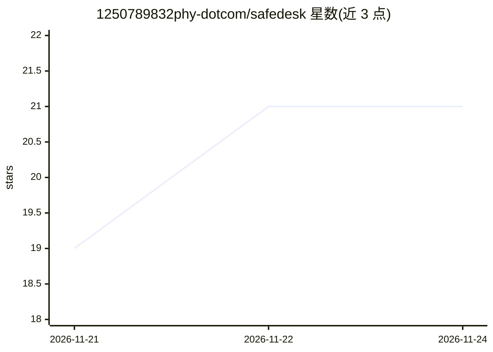

# 1250789832phy-dotcom/safedesk

⭐ 21 · Python · MIT · 推送 2026-11-22 · [GitHub](https://github.com/1250789832phy-dotcom/safedesk) · 个人维护 · 中文 README

**面向开发者的受控本地代码任务 Agent：diff 确认+固定测试+验收门禁**

SafeDesk 是一个本地运行的代码任务 Agent 应用，链路为规划→检索项目上下文→调用注册工具→生成候选改动→人工确认后应用→运行固定测试→输出验收报告。安全机制包括：文件访问限制在 workspace/ 内并校验目录边界、工具调用走注册表与参数校验、改动先出 diff 并经独立确认令牌落盘且写前备份、测试命令固定不接受模型拼接、失败如实上报。默认使用确定性 mock planner 以保证评测可重复，真实模型接入需通过环境变量或工作台配置 OpenAI 兼容服务。检索当前为关键词匹配，任务与记忆仅在进程内存中，面向本地单机使用。

## 筛选速览

| 维度 | 判定 | 备注 |
|---|---|---|
| AI 角色 | `ai-native` | 本体是模型或模型工具 |
| 许可风险 | `permissive` | MIT |
| 部署形态 | `desktop` | 安装包/桌面程序 |
| 模型依赖 | — | README 未给出锁定关系 |
| 硬件要求 | — | 无带数字的原话,不猜 |
| 安装摩擦 | `low` | 无编译、无系统依赖或容器化 |
| 成熟度 | `idea` | |

## 能力要点

- 候选改动先出 diff，经独立确认令牌落盘，写前备份可回滚
- 文件访问限定 workspace/ 边界，未注册工具直接拒绝
- 测试命令固定，测试失败如实上报为任务失败
- 默认确定性 mock planner，评测报告归因可重复验证

## 适用场景

- 让模型改代码时强制人工确认 diff 再落盘
- 需要测试门禁拦截模型把失败当成功上报的场景
- 本地单机环境中对代码任务执行过程做步骤化审计

## 场景标签

`编码 Agent` · 领域:编码与开发

## 证据(README 行号)

> L3: **一个受控执行代码任务的本地 Agent：规划 → 检索项目上下文 → 调用注册工具 → 生成候选改动 → 人工确认后应用 → 跑固定测试 → 输出验收报告。**
> L9: 让模型去改代码，最大的风险不是改错，而是**改到不该改的地方、绕过测试、把失败当成功上报**。SafeDesk 把这条链路拆成有边界、可审计的步骤：
> L13: - 候选改动先出 diff，经独立确认令牌后才落盘，写前备份、可回滚

## 星数曲线

2026-11-21 19 → 2026-11-24 21（+2）

---
*卡片 v1 · prompt 1.4 · 生成 2026-11-21 · 置信度 high · 依据 README sha `eac14da17f06` · [字段定义](../../DATASET.md)*
