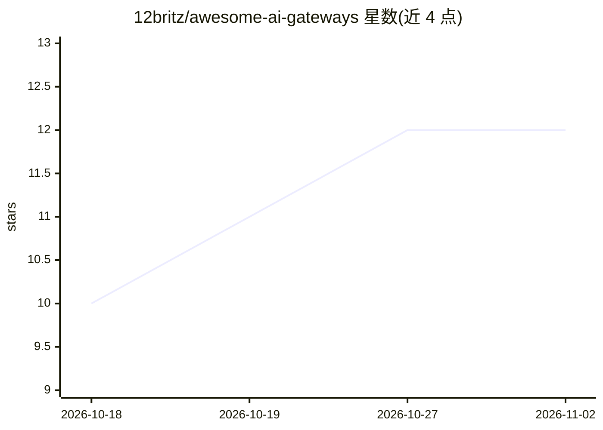

# 12britz/awesome-ai-gateways

⭐ 12 · NOASSERTION · 推送 2026-07-14 · [GitHub](https://github.com/12britz/awesome-ai-gateways) · 个人维护

**AI 网关与 LLM 路由基础设施的策展清单**

面向搭建生产级 AI 基础设施的开发者与团队，策展 AI 网关、LLM 路由、语义缓存、成本追踪、限流、可观测性与 Agent 编排等类别的开源工具、托管服务与库。条目覆盖统一 API 网关（LiteLLM、Portkey 等）、向量/语义缓存（RedisVL、Qdrant 等）、LLMOps 观测平台（Langfuse、Helicone 等）及多 Agent 框架，按目录组织并附一句话简介，供选型与发现工具使用。清单本身不含代码或安装流程。

## 筛选速览

| 维度 | 判定 | 备注 |
|---|---|---|
| AI 角色 | `ai-knowledge` | 知识聚合/清单类 |
| 许可风险 | `none` | NOASSERTION |
| 部署形态 | `None` |  |
| 模型依赖 | — | README 未给出锁定关系 |
| 硬件要求 | — | 无带数字的原话,不猜 |
| 安装摩擦 | `low` | 无编译、无系统依赖或容器化 |
| 成熟度 | — | 结构信号不足 |

## 能力要点

- 按 AI 网关、语义缓存、成本追踪、负载路由、观测、Agent 编排等类别组织条目
- 每类同时收录开源工具与托管服务
- 覆盖统一 API 网关、多 Provider 代理与自托管路由方案

## 适用场景

- 为 LLM 应用选型统一网关或路由方案
- 查找 LLM 成本追踪与可观测性工具
- 了解语义缓存与限流类基础设施选项

## 场景标签

`精选清单` · 领域:学习与行业

## 证据(README 行号)

> L1: # Awesome AI Gateways Awesome
> L3: > A curated list of tools, libraries, and resources for LLM routing, orchestration, and gateway infrastructure.
> L5: Managing 100+ LLM APIs, handling rate limits, implementing fallbacks, and tracking token costs is a massive operatio

## 星数曲线

2026-10-18 10 → 2026-11-02 12（+2）

---
*卡片 v1 · prompt 1.4 · 生成 2026-11-01 · 置信度 high · 依据 README sha `535bf0112f49` · [字段定义](../../DATASET.md)*
