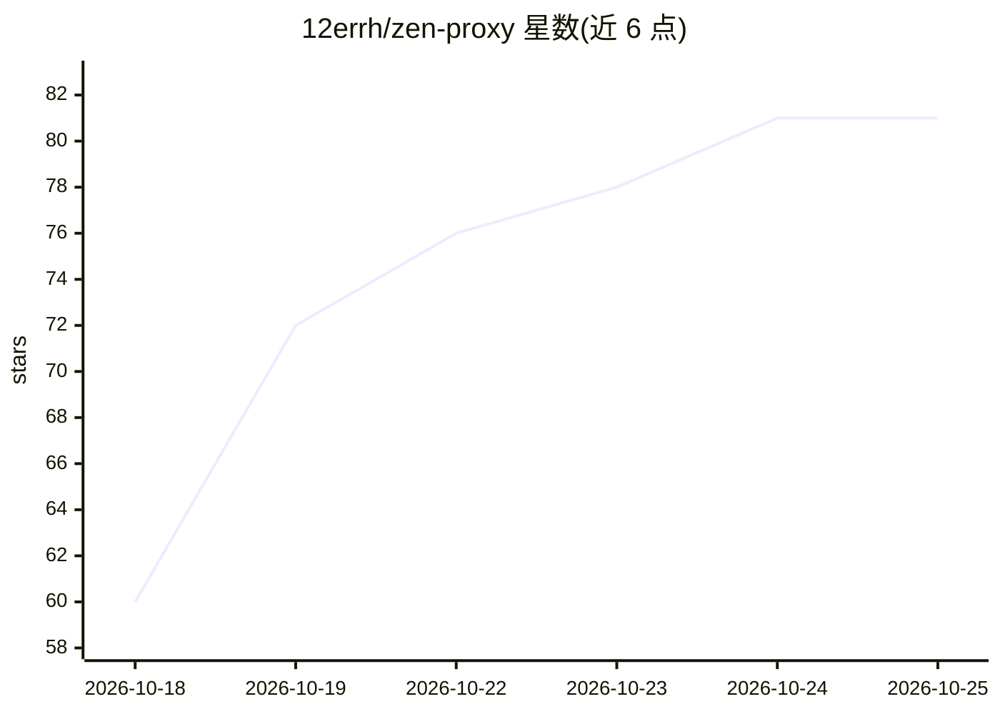

# 12errh/zen-proxy

⭐ 81 · JavaScript · MIT · 推送 2026-10-22 · [GitHub](https://github.com/12errh/zen-proxy) · 个人维护

**让任意编程 agent 使用 OpenCode Zen 免费模型的本地代理**

运行在本机的 Node.js 代理，将 OpenCode Zen 免费模型以 OpenAI 与 Anthropic 兼容 API 形式提供给任意编程 agent（Claude Code、Cline、Aider 等）。机制：在请求中注入 OpenCode 网关要求的会话头与工具清单，从而绕过“仅限 OpenCode CLI 使用”的 403 限制；提供 chat/completions、responses、messages 三种路由、模型自动回退与别名、每 6 小时刷新的模型目录及 dashboard。零依赖，Node 18+。限制：匿名访问共享每 IP 配额、可能饱和；依赖 OpenCode 工具 schema 抓取，其变更可能导致桥接失效。

## 筛选速览

| 维度 | 判定 | 备注 |
|---|---|---|
| AI 角色 | `ai-ecosystem` | LLM/agent 周边工具 |
| 许可风险 | `permissive` | MIT |
| 部署形态 | `library` | 以包/库形式分发 |
| 模型依赖 | — | README 未给出锁定关系 |
| 硬件要求 | — | 无带数字的原话,不猜 |
| 安装摩擦 | `low` | 无编译、无系统依赖或容器化 |
| 成熟度 | — | 结构信号不足 |

## 能力要点

- OpenAI Chat/Responses 与 Anthropic Messages 三类 API 路由的本地代理
- 注入网关会话头与 OpenCode 工具清单以通过免费层校验
- 429/5xx 自动回退到下一个免费模型，支持模型别名
- zen-claude 一键启动并生成 Claude Code 模型选择器，退出时自动清理

## 适用场景

- 在 Claude Code 中零配置使用免费模型
- 让 Cline/Continue/Aider 等任意 OpenAI 兼容 agent 通过本地 baseURL 使用免费模型
- 通过 dashboard 查看上游健康状态并即时修改配置

## 场景标签

`模型网关` · 领域:Agent 开发

## 证据(README 行号)

> L5:  No account. No API key. OpenAI&nbsp;and&nbsp;Anthropic&nbsp;compatible. Runs on your machine.
> L77: |`POST /v1/chat/completions`|OpenAI, streaming and not|
> L79: |`POST /v1/messages`|Anthropic Messages API — **this is the Claude Code one**|

## 星数曲线

2026-10-18 60 → 2026-10-25 81（+21）

---
*卡片 v1 · prompt 1.4 · 生成 2026-10-24 · 置信度 mid · 依据 README sha `e692aa53df49` · [字段定义](../../DATASET.md)*
