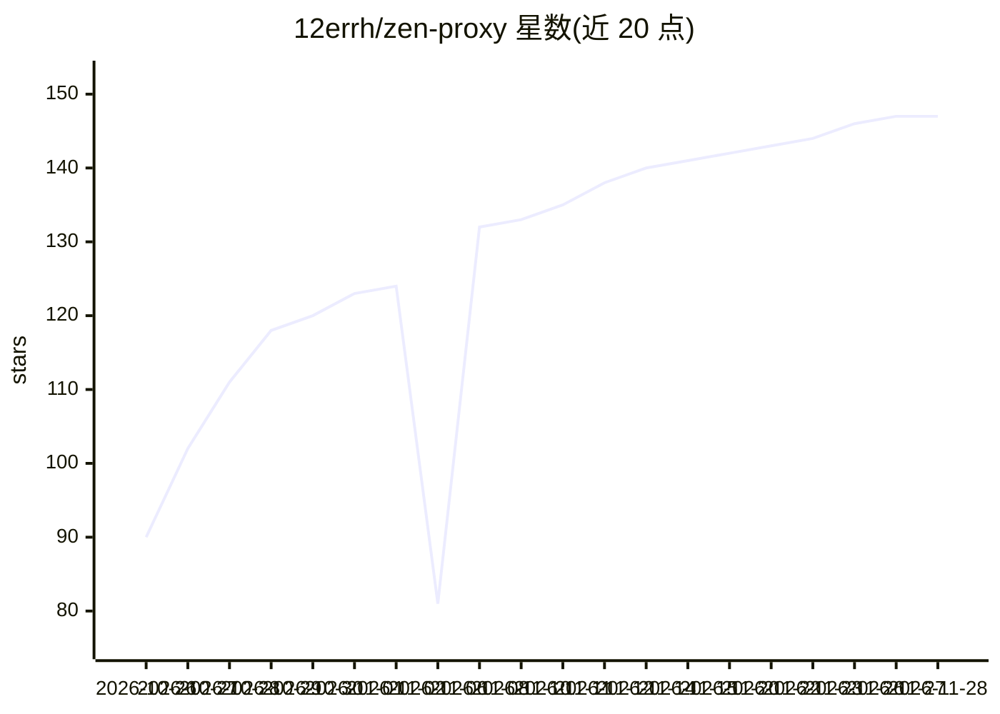

# 12errh/zen-proxy

⭐ 147 · JavaScript · MIT · 推送 2026-11-26 · [GitHub](https://github.com/12errh/zen-proxy) · 个人维护

**本地代理：让任意编码 agent 使用 OpenCode Zen 免费模型**

运行在本机的代理服务器，将 OpenCode Zen 的免费模型以 OpenAI 和 Anthropic 兼容接口（/v1/chat/completions、/v1/responses、/v1/messages）暴露给 Cline、Roo Code、Aider、Continue、Claude Code 等编码 agent，无需账号与 API key。通过模拟 OpenCode CLI 的请求特征（Bun 运行时、身份头、harness 前导与工具清单）通过网关校验，提供模型别名、故障回退、会话身份轮换、仪表盘与热重载配置。匿名免费层为共享 per-IP 配额，README 提示可能饱和，可自带 Zen key 提升稳定性。

## 筛选速览

| 维度 | 判定 | 备注 |
|---|---|---|
| AI 角色 | `ai-ecosystem` | LLM/agent 周边工具 |
| 许可风险 | `permissive` | MIT |
| 部署形态 | `library` | 以包/库形式分发 |
| 模型依赖 | — | README 未给出锁定关系 |
| 硬件要求 | — | 无带数字的原话,不猜 |
| 安装摩擦 | `low` | 无编译、无系统依赖或容器化 |
| 成熟度 | — | 结构信号不足 |

## 能力要点

- 提供 OpenAI 与 Anthropic Messages 兼容端点，流式与非流式均支持
- 429/5xx 时自动回退到下一个免费模型，回退经头字段公示
- 按调用方生成并每 30 分钟轮换 session+project 身份对
- 仪表盘支持健康查看、模型测试、配置热重载与日志

## 适用场景

- 让 Claude Code 或 Cline 使用 OpenCode Zen 免费模型
- 在多个编码 agent 间共享本地模型代理并各自持有身份
- 为不支持 Responses API 的客户端双向翻译请求格式

## 场景标签

`模型网关` · 领域:Agent 开发

## 证据(README 行号)

> L4:  Use OpenCode Zen's free models from any AI coding agent.
> L48: ### Any OpenAI-compatible agent
> L100: zen-proxy sits in front of that gateway and makes your agent's traffic indistinguishable from the CLI's, on three 

## 星数曲线

2026-10-26 90 → 2026-11-28 147（+57）

---
*卡片 v1 · prompt 1.4 · 生成 2026-11-27 · 置信度 mid · 依据 README sha `9958d44a391e` · [字段定义](../../DATASET.md)*
