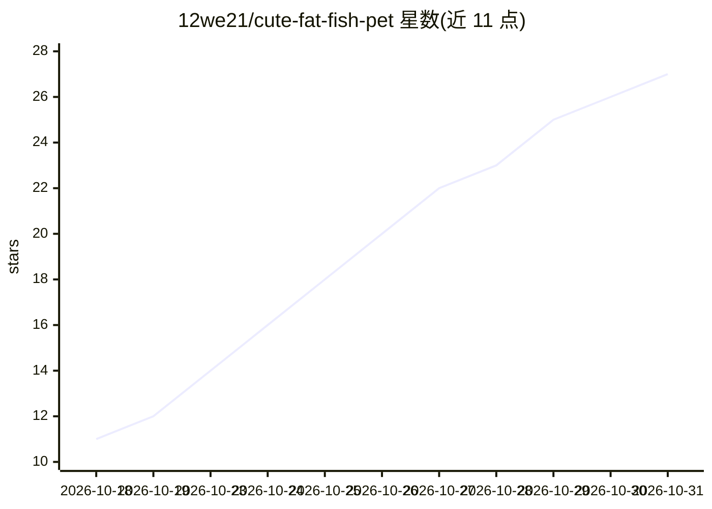

# 12we21/cute-fat-fish-pet

⭐ 27 · JavaScript · MIT · 推送 2026-10-27 · [GitHub](https://github.com/12we21/cute-fat-fish-pet) · 个人维护 · 中文 README

**Windows 桌面宠物：蓝发小女仆，支持本地/在线模型陪聊与语音**

基于 Electron 的 Windows 桌面宠物：106 个手绘透明动画（VP9-alpha webm 合成到壁纸），闲置、走动、随机动作。功能包括点击聊天（本地 Ollama 或任意 OpenAI 兼容端点，Local/Auto/Online 三模式）、可选的看屏幕吐槽（交给视觉模型）、代开应用/文件/URL、启动录屏（可接 OBS）、离线语音识别（sherpa-onnx + SenseVoice int8）与 Edge TTS 语音。提供 NSIS 安装器、便携版 zip 与 DeepSeek Harness 插件三种安装方式；单 HTML 控制台管理全部设置。数据存于 %APPDATA%，卸载不删除；尚无自动更新与自启动。MIT 许可。

## 筛选速览

| 维度 | 判定 | 备注 |
|---|---|---|
| AI 角色 | `ai-enhanced` | 去掉 AI 部分产品仍成立 |
| 许可风险 | `permissive` | MIT |
| 部署形态 | `desktop` | 安装包/桌面程序 |
| 模型依赖 | local-ok | 支持本地模型 |
| 硬件要求 | — | 无带数字的原话,不猜 |
| 安装摩擦 | `low` | 无编译、无系统依赖或容器化 |
| 成熟度 | — | 结构信号不足 |

## 能力要点

- 106 个手绘透明动画，权重与频率可配置
- 聊天支持本地 Ollama / OpenAI 兼容端点三模式
- 离线语音识别（sherpa-onnx + SenseVoice int8）+ Edge TTS
- 安装器即装即离线可用，免管理员权限

## 适用场景

- 桌面上养一只会聊天、会自己活动的桌面宠物
- 让她看屏幕并发表评论，或代开应用/文件/网页
- 从 U 盘便携运行桌宠，数据随目录走

## 场景标签

`聊天机器人` `语音合成` `语音识别` · 领域:对话与助手

## 证据(README 行号)

> L54: - **She moves on her own** — 106 hand-drawn transparent animations (VP9-alpha webm, composited onto your wallpaper 
> L55: - **She talks with you** — click her to open the chat. Local models through Ollama or any OpenAI-compatible endpoin

## 星数曲线

2026-10-18 11 → 2026-10-31 27（+16）

---
*卡片 v1 · prompt 1.4 · 生成 2026-10-28 · 置信度 high · 依据 README sha `0aa744a087c8` · [字段定义](../../DATASET.md)*
