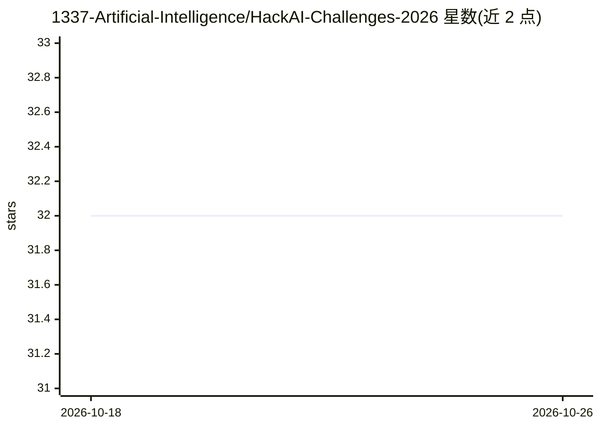

# 1337-Artificial-Intelligence/HackAI-Challenges-2026

⭐ 32 · Jupyter Notebook · 推送 2026-05-20 · [GitHub](https://github.com/1337-Artificial-Intelligence/HackAI-Challenges-2026) · [官网](https://1337ai.hackai.ma/) · 组织维护

**摩洛哥 HackAI 2026 黑客松：GenAI 挑战 notebook 路线图**

由 1337AI 学生团队组织的 4 天线下 AI 黑客松（2026 年 5 月 14-17 日，摩洛哥）配套仓库，收录可独立运行的挑战 notebook：涵盖 Darija（摩洛哥阿拉伯语）数据处理、LLM 继续预训练与 LoRA/QLoRA 微调、模型量化与 vLLM 部署、AI Agent 与 MCP、偏好对齐、ASR/TTS、RAG、VLM 微调与安全红队评测等类别，每项可在 Google Colab 打开。面向参赛学生，含奖金与导师信息。

## 筛选速览

| 维度 | 判定 | 备注 |
|---|---|---|
| AI 角色 | `ai-knowledge` | 知识聚合/清单类 |
| 许可风险 | `none` | — |
| 部署形态 | `None` |  |
| 模型依赖 | — | README 未给出锁定关系 |
| 硬件要求 | — | 无带数字的原话,不猜 |
| 安装摩擦 | `low` | 无编译、无系统依赖或容器化 |
| 成熟度 | — | 结构信号不足 |

## 能力要点

- 16 类挑战 notebook，每项自包含、可在 Colab 运行
- 多类别围绕 Darija（摩洛哥阿拉伯语）适配：预训练、ASR、嵌入微调、VLM 问答
- 覆盖量化（AWQ/GPTQ/GGUF）、vLLM 部署、MCP、GRPO 推理训练等主题

## 适用场景

- 按路线图学习当前 GenAI 技能并动手做挑战
- 参赛者获取赛题 notebook 与活动安排
- 查找 Darija 语言 LLM/ASR 适配的实践材料

## 场景标签

`教程课程` · 领域:学习与行业

## 证据(README 行号)

> L45: ### Available Notebooks
> L46: The roadmap covers the following challenges. Each notebook is self-contained and ready to run.

## 星数曲线

2026-10-18 32 → 2026-10-26 32（+0）

---
*卡片 v1 · prompt 1.4 · 生成 2026-10-26 · 置信度 high · 依据 README sha `1335657b37c0` · [字段定义](../../DATASET.md)*
