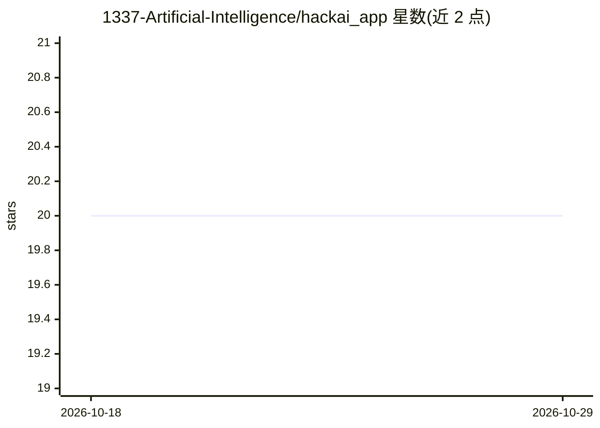

# 1337-Artificial-Intelligence/hackai_app

⭐ 20 · JavaScript · NOASSERTION · 推送 2025-12-28 · [GitHub](https://github.com/1337-Artificial-Intelligence/hackai_app) · [官网](https://hackai.ma/leaderboard) · 组织维护

**面向学生与团队的 AI 学习与挑战（黑客松）协作平台**

ThinkAI 是一个 AI 学习与挑战平台，用于帮助学生和团队围绕 AI 项目与挑战开展协作。功能包括用户认证与基于角色的访问控制（admin/mentor/team）、挑战创建与管理、团队协作工具、项目提交与验证。架构分为两部分：Node.js + Express + MongoDB 的后端 API，以及 React 前端。仓库另含创建管理员、从 CSV 导入导师与团队账号的实用脚本；敏感配置全部通过环境变量管理。Apache 2.0 许可，但公开活动中使用须在界面与宣传材料中显示署名。

## 筛选速览

| 维度 | 判定 | 备注 |
|---|---|---|
| AI 角色 | `ai-enhanced` | 去掉 AI 部分产品仍成立 |
| 许可风险 | `none` | NOASSERTION |
| 部署形态 | `library` | 以包/库形式分发 |
| 模型依赖 | — | README 未给出锁定关系 |
| 硬件要求 | — | 无带数字的原话,不猜 |
| 安装摩擦 | `low` | 无编译、无系统依赖或容器化 |
| 成熟度 | — | 结构信号不足 |

## 能力要点

- 基于角色的访问控制（管理员/导师/团队）
- 挑战创建与管理、团队协作、项目提交与验证
- 前后端分离：Express+MongoDB 后端与 React 前端
- 附带的 CSV 批量创建导师/团队账号脚本

## 适用场景

- 高校或社团组织 AI 黑客松与挑战赛
- 导师管理学生团队并跟进项目提交
- 团队在平台上协作完成 AI 挑战项目

## 场景标签

 · 领域:教育/竞赛平台

## 证据(README 行号)

> L3: ThinkAI is an AI learning and challenge platform designed to help students and teams collaborate on AI projects and 
> L7: - User authentication and role-based access control (admin, mentor, team)

## 星数曲线

2026-10-18 20 → 2026-10-29 20（+0）

---
*卡片 v1 · prompt 1.4 · 生成 2026-10-28 · 置信度 mid · 依据 README sha `c69617518148` · [字段定义](../../DATASET.md)*
