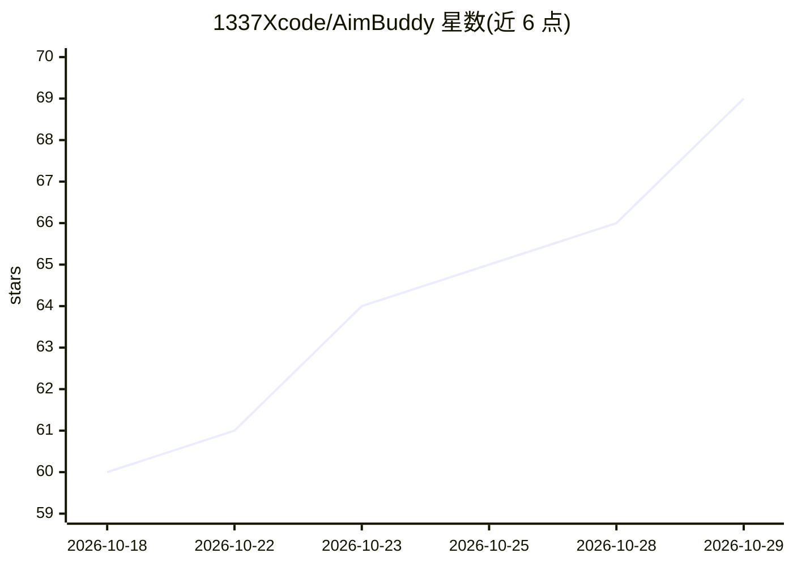

# 1337Xcode/AimBuddy

⭐ 69 · C++ · NOASSERTION · 推送 2026-10-28 · [GitHub](https://github.com/1337Xcode/AimBuddy) · [官网](https://1337xcode.github.io/AimBuddy) · 个人维护 · 中文 README

**Android 端实时目标检测辅助应用，供视障玩家检测和追踪对手**

面向视障玩家的 Android 原生应用：通过 MediaProjection 屏幕截取、NCNN 运行时（Vulkan GPU 加速）运行 YOLOv26n 推理检测对手，DeepSORT 式追踪维持目标身份，绘制 ESP 框与牵引线叠加层；可选辅助输入模式经 root(uinput) 或非 root(Shizuku) 后端并行注入触摸，无后端时保持纯视觉辅助模式。附带 Windows 端 Python 训练流水线（教师自动标注、负样本挖掘、NCNN 导出与主动学习）。需 Android 11+、arm64-v8a，从源码用 Gradle 构建安装；README 声明仅在授权且合规环境使用。自定义许可证 AimBuddy Community Free Use License v1.0。

## 筛选速览

| 维度 | 判定 | 备注 |
|---|---|---|
| AI 角色 | `ai-native` | 本体是模型或模型工具 |
| 许可风险 | `none` | NOASSERTION |
| 部署形态 | `None` |  |
| 模型依赖 | — | README 未给出锁定关系 |
| 硬件要求 | — | 无带数字的原话,不猜 |
| 安装摩擦 | `high` | 编译与系统依赖俱全 |
| 成熟度 | — | 结构信号不足 |

## 能力要点

- NCNN + Vulkan GPU 运行 YOLOv26n 实时检测（推理目标 <10ms，自适应裁剪）
- 双后端并行触控注入：root(uinput) 与非 root(Shizuku)，可与用户手指同时操作
- 教师自动标注 + 负样本挖掘 + 主动学习的端到端训练流水线
- 支持中英文 UI 与主播模式（FLAG_SECURE 隐藏录屏画面）

## 适用场景

- 视障玩家在游戏中获取对手位置的可视化语音/叠加提示
- 通过 ESP 框和牵引线实时追踪屏幕中的目标
- 用自己的游戏录像训练并部署定制检测模型

## 场景标签

`目标检测` · 领域:感知与多模态

## 证据(README 行号)

> L3: AimBuddy is an AI-based Android aim assistant for real-time screen capture, object detection, target tracking, visua
> L9: - **Inference**: NCNN runtime with Vulkan GPU acceleration (YOLOv26n)
> L40: 1. **Capture**: MediaProjection captures the game screen at 1280x720.
> L41: 2. **Detect**: YOLOv26n runs on the GPU via NCNN to detect enemies.

## 星数曲线

2026-10-18 60 → 2026-10-29 69（+9）

---
*卡片 v1 · prompt 1.4 · 生成 2026-10-24 · 置信度 high · 依据 README sha `97043095a8b4` · [字段定义](../../DATASET.md)*
