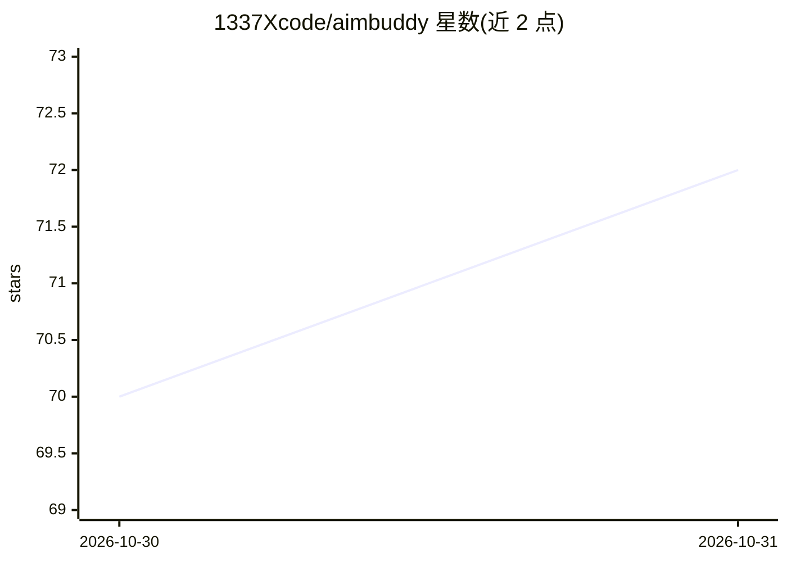

# 1337Xcode/aimbuddy

⭐ 72 · C++ · NOASSERTION · 推送 2026-10-30 · [GitHub](https://github.com/1337Xcode/aimbuddy) · [官网](https://1337xcode.github.io/aimbuddy) · 个人维护

**Android 端到设备瞄准辅助：视觉检测+辅助转向（aimbot 类）**

面向低视力或运动障碍玩家的 Android 应用：读取屏幕画面，用 NCNN 模型（CPU 或 Vulkan）或实验性颜色匹配在游戏画面中检测人物，绘制标记（Dear ImGui overlay），并通过 Shizuku 或 root 启动的触摸 helper 注入额外手指，配合自校准的控制器（拟合相机增益与延迟）将视角转向最近目标。全部在设备上运行，仅用 GitHub 做模型分发与更新检查。面向触屏 3D 射击游戏玩家；许可证为 AimBuddy Community Free Use。

## 筛选速览

| 维度 | 判定 | 备注 |
|---|---|---|
| AI 角色 | `ai-native` | 本体是模型或模型工具 |
| 许可风险 | `none` | NOASSERTION |
| 部署形态 | `None` |  |
| 模型依赖 | — | README 未给出锁定关系 |
| 硬件要求 | — | 无带数字的原话,不猜 |
| 安装摩擦 | `high` | 编译与系统依赖俱全 |
| 成熟度 | — | 结构信号不足 |

## 能力要点

- NCNN 模型检测（CPU/Vulkan）+ 实验性无模型颜色匹配
- 从自身操作拟合游戏相机增益与延迟的控制回路
- Shizuku/root 启动的触摸 helper 注入额外手指
- 完全端上运行，仅模型商店与更新检查访问 GitHub

## 适用场景

- 触屏射击游戏中为低视力或运动障碍玩家辅助瞄准
- 在画面上标记检测到的人物目标
- 开启转向后由控制器将镜头移向最近目标

## 场景标签

`目标检测` · 领域:感知与多模态

## 证据(README 行号)

> L18: AimBuddy is built for players with low vision or motor impairments, for whom fast, precise aiming on a touchscreen 
> L25: |Sees with|An NCNN model on the CPU or through Vulkan, or an experimental colour matcher that needs no model|

## 星数曲线

2026-10-30 70 → 2026-10-31 72（+2）

---
*卡片 v1 · prompt 1.4 · 生成 2026-10-30 · 置信度 high · 依据 README sha `8d825784a907` · [字段定义](../../DATASET.md)*
