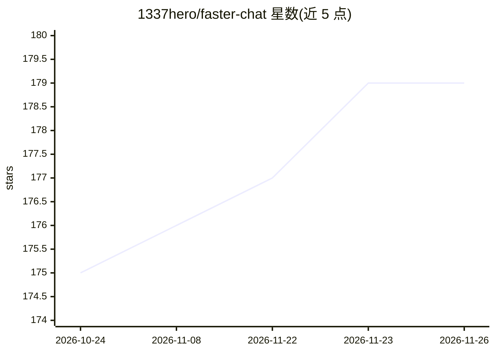

# 1337hero/faster-chat

⭐ 179 · JavaScript · MIT · 推送 2026-11-19 · [GitHub](https://github.com/1337hero/faster-chat) · [官网](https://www.fasterchat.ai) · 个人维护

**自托管隐私优先的多提供商 LLM 聊天界面**

基于 Preact + Hono + Bun 的自托管聊天界面，接入 17 个内置提供商并可通过 models.dev 自动发现 50+ 提供商，支持云端 API 与本地模型（Ollama/LM Studio/llama.cpp）完全离线运行。提供服务器端 SQLite 会话存储、跨会话记忆提取、Brave 网页搜索与来源引用、图像分析与生成、语音输入输出，以及多用户角色认证、管理面板、加密 API key 存储和白标定制。Docker 一键部署，可选 Caddy HTTPS；当前处于维护模式。

## 筛选速览

| 维度 | 判定 | 备注 |
|---|---|---|
| AI 角色 | `ai-ecosystem` | LLM/agent 周边工具 |
| 许可风险 | `permissive` | MIT |
| 部署形态 | `self-host` | docker 或自建部署 |
| 模型依赖 | local-ok | 支持本地模型 |
| 硬件要求 | — | 无带数字的原话,不猜 |
| 安装摩擦 | `low` | 无编译、无系统依赖或容器化 |
| 成熟度 | — | 结构信号不足 |

## 能力要点

- 17 个内置提供商，另可经 models.dev 自动发现 50+ 提供商
- 可完全离线运行，管理面板内直接拉取 Ollama 模型
- 跨会话记忆：响应后异步提取、三级控制、用户级隔离
- 多用户角色认证与管理面板、服务器端加密 API key 存储

## 适用场景

- 自托管一个不依赖单一厂商的私人聊天界面
- 配合本地 Ollama/LM Studio 模型完全离线使用
- 小团队内提供带权限管理与白标的共享 AI 聊天服务

## 场景标签

`聊天机器人` `AI 助手` · 领域:对话与助手

## 证据(README 行号)

> L31: > **A blazingly fast, privacy-first chat interface for AI that works with any LLM provider—cloud or completely offl
> L43: - 🤖 **17 built-in providers** (plus 50+ more auto-discoverable via models.dev): OpenAI, Anthropic, Google, Google V
> L239: Faster Chat has reached its stated goal — a lighter, faster, more private alternative to Open WebUI — and is now i

## 星数曲线

2026-10-24 175 → 2026-11-26 179（+4）

---
*卡片 v1 · prompt 1.4 · 生成 2026-11-26 · 置信度 mid · 依据 README sha `8d692e8627c6` · [字段定义](../../DATASET.md)*
