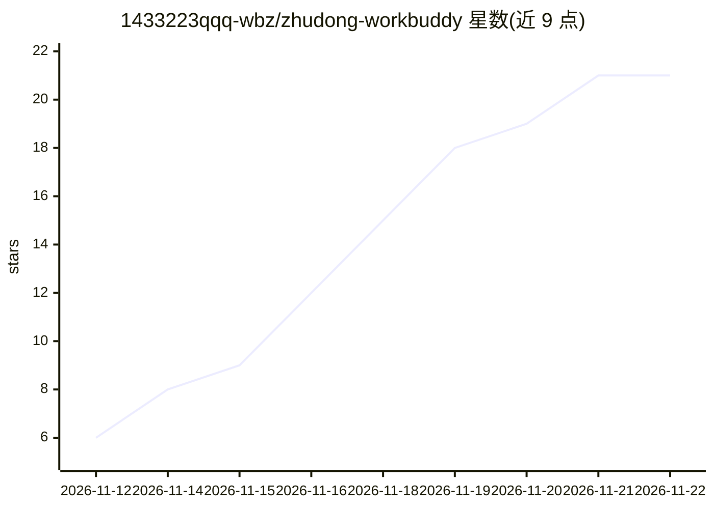

# 1433223qqq-wbz/zhudong-workbuddy

⭐ 21 · PowerShell · MIT · 推送 2026-11-11 · [GitHub](https://github.com/1433223qqq-wbz/zhudong-workbuddy) · 个人维护 · 中文 README

**给 WorkBuddy 客户端安装「诛冬」人格与提示词契约的脚本安装包**

面向 WorkBuddy 5.x（Windows 10/11 + macOS）的纯脚本安装包，通过五条通道修改 `~/.workbuddy` 下的人格文件、hook、output style、memory 与 agent 配置，把默认 agent 的 instructions 替换为「诛冬」人格与运行契约。安装器解密加密载荷（SHA256-CTR + HMAC-SHA256 校验、零宽字符水印），改动前留时间戳备份，提供一键安装/卸载/自检脚本。hook 注入依赖 python3，缺失时仅人格文件生效。含免责声明，声明不提供服务器或接口、修改第三方客户端本地数据存在平台条款风险。

## 筛选速览

| 维度 | 判定 | 备注 |
|---|---|---|
| AI 角色 | `ai-ecosystem` | LLM/agent 周边工具 |
| 许可风险 | `permissive` | MIT |
| 部署形态 | `None` |  |
| 模型依赖 | — | README 未给出锁定关系 |
| 硬件要求 | — | 无带数字的原话,不猜 |
| 安装摩擦 | `low` | 无编译、无系统依赖或容器化 |
| 成熟度 | — | 结构信号不足 |

## 能力要点

- 五通道安装：人格文件 / hook / output style / memory / agent（agent 通道替换默认 instructions）
- 载荷加密（SHA256-CTR + 逐文件 HMAC-SHA256）与零宽字符水印（编码 build id）
- 安装/卸载/自检三套脚本，改动前留 `*.bak-<时间戳>` 备份
- 提供 `inspect-payload.ps1` 在不安装的情况下查看载荷内容

## 适用场景

- 给本机 WorkBuddy 客户端安装并验证一套自定义人格与运行契约
- 安装后按五条通道自检生效状态、排查人格未生效问题
- 通过卸载脚本从备份还原原有配置

## 场景标签

`提示工程` · 领域:Agent 开发

## 证据(README 行号)

> L3: 给 **WorkBuddy 5.x**（Windows 10/11 + macOS）装一套「诛冬」人格与运行契约的**纯脚本安装包**。
> L24: |2|hook|`~/.workbuddy\zhudong\hook.ps1`（+ `hook.sh`）、`kernel.md`、`reminder.md`|高|`settings.json` 写两条：`SessionStart`
> L27: |5|agent|`~/.workbuddy\agents\zhudong.md` + `settings.agent = zhudong`|**最高**|`settings.agent` 直接把默认 agent 的 instru

## 星数曲线

2026-11-12 6 → 2026-11-22 21（+15）

---
*卡片 v1 · prompt 1.4 · 生成 2026-11-18 · 置信度 high · 依据 README sha `4ef7f59bc229` · [字段定义](../../DATASET.md)*
